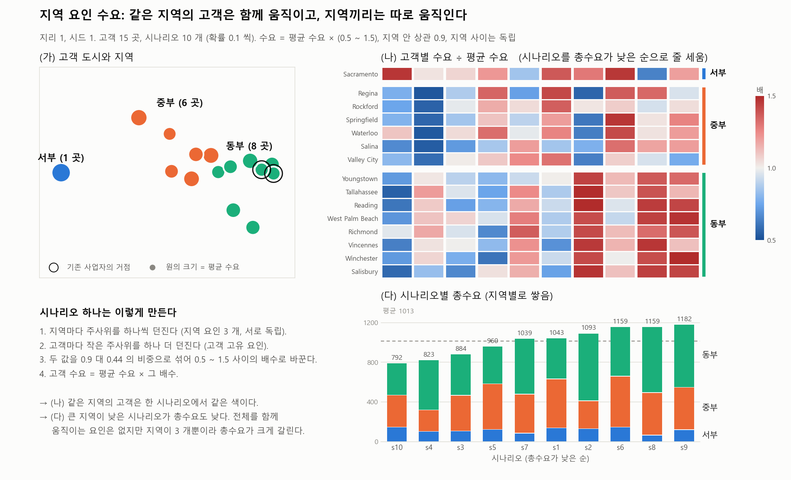
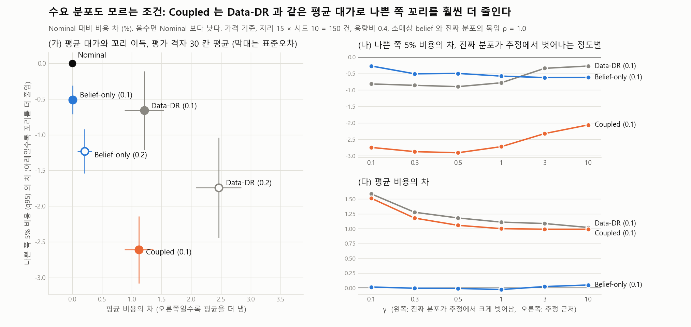
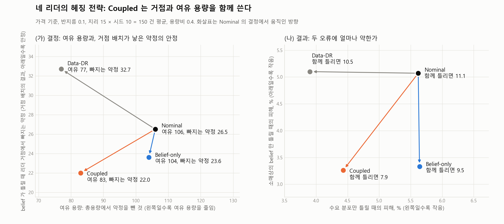

# 입지 게임에서 소매상 belief 헤징의 가치: 분석 리포트

2026-11-17 기준. 비제로섬 입지 게임 (원고 6.2 절) 에서 소매상 (follower) 의 belief 를 헤징하는 것이 리더에게 값어치가 있는지를 다룬다. 본문은 지금의 모형, 평가 방식, 결과만 적는다. 결정이 난 경위, 이전 식과 이전 평가 방식의 결과, 세부 수리는 부록에 있다. 원고 tex 와 저장소 코드는 바뀐 것이 없다.

## 1. 결론

리더의 비용을 $J(x;\, a,\, d)$ 로 쓴다. $x$ 는 리더의 결정, $a$ 는 수요의 분포, $d$ 는 소매상이 믿는 분포다. 숫자는 Nominal 대비 비용 차 (%) 이고 음수면 Nominal 보다 낫다. 가격 기준 식, 지리 15 × 시드 10 = 150 건.

| | 결론 | 숫자 |
|---|---|---|
| 1 | **Belief-only 는 나쁜 쪽 꼬리를 1% 안팎 줄이고 평균은 거의 내지 않는다.** 평가 격자 30 칸, 두 조건 모두에서 부호가 같다 | 수요 분포를 아는 조건 $q_{95}$ $-1.40 \pm 0.45$, 평균 $-0.05 \pm 0.17$. 모르는 조건 $q_{95}$ $-0.94 \sim -0.99$, 평균 $-0.03 \sim +0.20$ |
| 2 | **Data-DR 은 꼬리를 조금 더 줄이지만 평균을 훨씬 많이 낸다.** 꼬리 이득은 진짜 분포가 추정에서 크게 벗어난 세계에만 있다 | 반지름 0.1 에서 $q_{95}$ $-1.25 \sim -1.70$, 평균 $+1.57 \sim +2.13$. 진짜 분포가 추정 근처인 칸에서는 $q_{95}$ $+0.41$, 평균 $+1.13$ |
| 3 | **Nominal 이 잃는 것은 대부분 소매상의 약정을 잘못 예상한 데서 온다.** 수요 분포 자체를 틀린 것의 몫은 작다 | 소매상 belief 만 맞게 알면 손해의 66~84% 가 없어지고, 수요 분포만 맞게 알면 28~38% 가 없어진다 |
| 4 | **두 헤징은 서로 다른 손잡이를 쓴다.** Belief-only 는 거점을 옮기고 Data-DR 은 약정을 넘는 여유 용량을 줄인다. 학습 분포의 CVaR 로 내는 비용은 같고, Data-DR 만 수요가 높은 시나리오의 수입을 내준다 (4.4) | 여유 용량 Nominal 106, Belief-only 104, Data-DR 73 (반지름 0.1) · 50 (0.3). 학습 분포의 기대값 기준 비용 $+1.32$ 대 $+4.16$ |
| 5 | **Coupled 는 Data-DR 과 같은 평균 대가로 꼬리를 훨씬 더 줄인다.** 꼬리 이득이 두 헤징을 따로 한 것의 합보다 크다. 판정 기준인 꼬리로는 Belief-only 보다도 낫고, 그 대가로 평균을 1 가량 더 낸다 (4.5, 새 집합) | 수요 분포도 모르는 조건 ($\rho = 1$, 30 칸 평균): Coupled 평균 $+1.12 \pm 0.24$, $q_{95}$ $-2.61 \pm 0.47$. Data-DR (0.1) $+1.21$, $-0.66$. Belief-only (0.1) $+0.01$, $-0.51$ |
| 6 | **손잡이는 따로이고, 두 오류가 함께 오면 교차항이 더 붙는다. Coupled 는 두 손잡이를 함께 쓰고 교차항도 줄인다.** 수요 분포가 틀리면 추가 주문 수입이, belief 가 틀리면 약정 수입이 흔들린다. 여유 용량은 앞의 피해만 바꾸고 거점 배치는 뒤의 피해를 바꾼다. Belief-only 와 Coupled 의 배치에서는 소매상이 줄이는 약정이 기존 사업자 쪽으로 간다 (4.6) | 함께 올 때의 피해 = 수요 쪽 + belief 쪽 + 교차항: Nominal 11.1 = 4.9 + 3.6 + 2.6, Belief-only 9.5 = 5.1 + 2.2 + 2.3, Data-DR 10.5 = 3.5 + 4.1 + 2.9, Coupled 7.9 = 3.9 + 2.0 + 2.1. 리더 거점의 약정 감소 13.7, 11.7, 15.2, 10.6 |
| 7 | **두 불확실성을 따로 헤징하면 놓치는 항이 있다 (논문의 줄기로 제안).** 수요 분포와 소매상의 belief 가 같은 방향으로 틀리면, 피해는 두 피해의 합보다 크다. 진짜 분포가 무게를 더한 저수요 시나리오에서 그 분포를 믿은 소매상의 약정도 줄어 있기 때문이다. Data-DR 은 소매상이 $\hat q$ 를 믿는다고 두고 Belief-only 는 진짜가 $\hat q$ 라고 두므로 둘 다 이 항을 모형에 갖고 있지 않다. 두 분포를 묶는 Coupled 만 본다 (4.6) | 교차항은 함께 올 때 피해의 약 4 분의 1 이다. Nominal 2.6 / 11.1, Belief-only 2.3 / 9.5, Data-DR 2.9 / 10.5, Coupled 2.1 / 7.9. Nominal 대비 Coupled $-0.50 \pm 0.17$, Data-DR $+0.29 \pm 0.16$ |

## 2. 모형

### 2.1 게임과 소매상

기존 사업자의 거점 $I_A$ (2 곳) 는 이미 열려 있다. 리더는 후보지 $I_B$ (13 곳) 가운데 최대 $N_B = 3$ 곳에 점포를 열고 점포마다 크기 $b^k$ 를 고른다 ($x_i^k \in \{0,1\}$, $b_i(x) = \sum_k b^k x_i^k$).

소매상은 고객 $j$ 의 수요 $\xi_j$ 를 모든 거점에서 조달한다. 같은 물건을 수요를 보기 전에 미리 사면 선구매가 $f$, 본 뒤에 사면 정가 $p > f$ 다. 소매상은 belief $d$ 아래에서 거점별 선구매량 (약정량) $h_i$ 를 정한다.

$$h(x, d) \in \arg\min_{0 \le h_i \le w_i} \; f \sum_i h_i + \mathbb{E}_{\xi \sim d}\bigl[\,Q(x, h, \xi)\,\bigr],$$

$$Q(x, h, \xi) = \min_{y^R,\, y^S,\, s \,\ge 0} \; \sum_{i,j} \bigl[\, c_{ij}\, y^R_{ij} + (c_{ij} + p)\, y^S_{ij} \,\bigr]$$

$$\text{s.t.}\quad \sum_i (y^R_{ij} + y^S_{ij}) \ge \xi_j \;\;\forall j, \qquad \sum_j y^R_{ij} + s_i = h_i \;\;\forall i, \qquad h_i + \sum_j y^S_{ij} \le b_i \;\;\forall i .$$

$y^R$ 은 선구매분에서 쓴 물량, $y^S$ 는 정가로 더 산 물량 (추가 주문), $s_i$ 는 선구매했지만 쓰지 않은 물량이다. 선구매분은 쓰든 안 쓰든 값을 치렀다. 수요는 항상 충족된다고 가정한다.

### 2.2 리더

리더의 수입은 소매상이 리더의 점포에 낸 돈이다.

$$\varphi(x, h, \xi) = \max\Bigl\{ -\sum_{i \in I_B} \Bigl[\, f\,\Bigl(\sum_j y^R_{ij} + s_i\Bigr) + p \sum_j y^S_{ij} \Bigr] \;:\; (y^R, y^S, s) \text{ 가 } Q(x, h, \xi) \text{ 의 최적해} \Bigr\},$$

$$J(x;\, a,\, d) = \sum_{i \in I_B}\sum_k (q_0 + c\, b^k)\, x_i^k \;+\; \mathrm{CVaR}_\beta^{\,\xi \sim a}\bigl[\, \varphi(x,\, h(x, d),\, \xi) \,\bigr].$$

$q_0$ 는 개설비, $c$ 는 용량 한 단위를 짓는 비용이다. 제약 $\sum_j y^R_{ij} + s_i = h_i$ 때문에 괄호 안은 약정량 $h_i$ 와 같다. 리더의 손실을 2 단계 변수의 선형식으로 적으려고 이렇게 쓴다. 소매상의 최적해가 여럿이면 리더에게 불리한 쪽을 택한다. 리더 쪽 금액은 $f$ 를 1 로 놓고 읽는다. 거점을 하나로 줄이면 리더의 이익은 $f\,h + p \min\{(\xi - h)^+,\, b - h\} - c\,b$ 이고 Cachon (2004) 의 선구매 할인 계약 (잔존가치 0) 과 같다 (부록 C).

### 2.3 네 가지 리더

서포트는 시나리오 $S = 10$ 개로 고정이고 리더의 추정은 균등 $\hat q$ 다. 진짜 분포와 소매상 belief 는 같은 10 개 위에서 확률만 다르다. 반지름 $r$ 인 집합은 $\hat q$ 를 기준으로 한 TV 볼과 상자의 교집합이다.

$$\mathcal{U}(r) = \Big\{\pi \in \Delta_S :\ \mathrm{TV}(\pi, \hat q) \le r,\ \ |\pi_s - \hat q_s| \le \frac{r}{\sqrt S} \ \ \forall s \Big\}.$$

| 리더 | 푸는 문제 | 움직이는 자리 |
|---|---|---|
| Nominal (N) | $\min_x J(x;\, \hat q,\, \hat q)$ | 없음 |
| Data-DR (D) | $\min_x \max_{a \in \mathcal{U}(r)} J(x;\, a,\, \hat q)$ | 수요 분포만 |
| Belief-only (B) | $\min_x \max_{d \in \mathcal{U}(r)} J(x;\, \hat q,\, d)$ | 소매상 belief 만 |
| Coupled (C) | $\min_x \max \{ J(x;\, a,\, d) : a \in \mathcal{U}(\hat\epsilon),\ d \in \mathcal{U}(\tilde\epsilon),\ \mathrm{TV}(a, d) \le \delta \}$ | 둘 다. 두 분포는 $\delta$ 로 묶임 |

상자 폭 $r/\sqrt S$ 는 Sadana–Delage 의 집합과 같은 꼴이고 조절하는 값은 $r$ 하나다. 반지름은 본 구성 $r = 0.1$, 민감도 $r = 0.2$ 다.

**4 절의 결과가 쓴 집합.** Belief-only 는 반지름 0.1, Data-DR 은 반지름 0.1 이다. (메모: 이 결과를 풀 때 Belief-only 의 belief 집합에는 상자를 넣지 않았고 Data-DR 의 상자 폭은 $2r/\sqrt S$ 였다. 위 정의대로 다시 푼 결과는 나중에 더한다.)

## 3. 실험 설계

### 3.1 인스턴스

| 항목 | 값 |
|---|---|
| 지리 | SGB128 에서 뽑은 15 개 도시 조합 15 개. $I_A$ 2 곳, $I_B$ 13 곳 |
| 수요 | 지역 요인 모형 (상관 0.9), 시나리오 10 개, 시드 10 개. 지리 15 × 시드 10 = 150 건 |
| 값 | $f/p = 0.75$, 선구매 상한 $w_i = 300$, 수송비는 거리 |
| 점포 | 크기 단계 200·300·400. 점포비 $q_0 + c\,b^k$, 본 구성 $(q_0, c) = (30, 0.4)$, 민감도 $(0, 0.5)$ ($f$ 를 1 로 놓은 단위) |
| 그 밖 | $N_B = 3$, $\beta = 0.4$ |
| 결정 공간 | 입지 3 곳 이하 × 거점별 크기, 8,463 개. Nominal 과 Data-DR 은 전체 열거, Belief-only 는 후보 약 40 개에서 선택 |

본 구성의 점포비는 개설비가 있는 쪽이다. 같은 총용량을 여러 곳에 나눠 지으면 개설비만큼 손해이므로 몇 곳을 열지가 비용과 맞물린다. 크기 단계를 하나로 두면 Yanıkoğlu–Kuhn 과 Goyal 의 모형 (개설비만 내고 크기는 주어짐) 으로 돌아간다.

**수요 시나리오.** 고객 15 곳을 경도로 서부·중부·동부 세 지역으로 나눈다. 시나리오 $s$ 에서 고객 $j$ 의 수요는

$$\xi_{js} = \mu_j \left( 0.5 + \Phi\!\left( 0.9\, Z_{r(j),s} + \sqrt{1 - 0.9^2}\; E_{js} \right) \right)$$

이다. $\mu_j$ 는 평균 수요, $r(j)$ 는 고객 $j$ 의 지역, $Z_{r,s}$ 는 지역 요인, $E_{js}$ 는 고객 고유 요인이고 모두 서로 독립인 표준정규다. $\Phi$ 는 표준정규 분포함수라 수요는 평균의 0.5~1.5 배다. 같은 지역의 고객은 함께 움직이고 지역끼리는 독립이다. 모든 고객을 함께 움직이는 요인은 없다. 지역이 3 개뿐이라 큰 지역이 낮은 시나리오에서 총수요도 낮다 (150 건 평균으로 총수요의 최소/최대 0.60, 총수요가 낮은 세 시나리오에서 고객의 79% 가 자기 중앙값 아래).

*그림 1. 지리 1, 시드 1 의 수요 시나리오. (가) 고객 도시와 지역. (나) 고객별 수요를 평균 수요로 나눈 값, 시나리오는 총수요가 낮은 순. (다) 시나리오별 총수요.*

### 3.2 평가 방식

결정 $x$ 와 서포트 (시나리오 10 개) 는 고정이다. 평가에서 바뀌는 것은 서포트 위의 확률벡터 둘, 곧 수요의 진짜 분포 $p^{\text{true}}$ 와 소매상의 belief $d$ 이고, 평가값은 $J(x;\, p^{\text{true}},\, d)$ 다.

확률벡터는 원고 6.1 절의 zero-sum 실험과 같은 규칙으로 뽑는다.

$$\alpha_k = \max\{\gamma\,(1 + \zeta z_k),\; 0.01\}, \quad z_k \sim N(0,1), \qquad \pi \sim \mathrm{Dir}(\alpha) .$$

$\zeta$ 는 뽑히는 분포의 평균을 $\hat q$ 에서 떼어 놓고, $\gamma$ 는 그 평균 둘레의 퍼짐을 정한다. $\zeta = 0$ 일 때 $\gamma$ 는 "$\hat q$ 가 시나리오마다 $\gamma$ 번 관측한 만큼 믿을 만하다" 로 읽힌다. $\gamma \le 1$ 이면 확률이 시나리오 서너 개에 몰리고, $\gamma = 10$, $\zeta = 0$ 이면 $\hat q$ 에서 조금만 벗어난다.

| 조건 | 진짜 분포 | 소매상 belief |
|---|---|---|
| 수요 분포를 앎 | $\hat q$ | $\pi$ |
| 수요 분포도 모름 | $\pi$ | $\rho\,\pi + (1-\rho)\,\tilde\pi$ ($\pi$, $\tilde\pi$ 는 독립) |

$\rho = 1$ 은 소매상이 진짜 분포를 아는 경우, $\rho = 0$ 은 belief 가 진짜 분포와 독립인 경우다 ($\rho = 0.5$ 의 상관계수는 0.71).

- 격자: $\gamma \in \{0.1, 0.3, 0.5, 1, 3, 10\}$, $\zeta \in \{0, 0.5, 1, 2, 5\}$ 의 30 칸, 건마다 칸마다 100 번.
- 지표: 칸마다 뽑힌 표본에 대한 비용의 평균과 $q_{95}$ (나쁜 쪽 꼬리). Nominal 과의 차이를 Nominal 의 학습 비용 대비 % 로 적고, 150 건의 평균과 표준오차 (지리 15 개 단위) 를 보고한다.
- 평가 분포는 모호성 집합을 정의한 TV 거리로 고르지 않는다. 뽑힌 분포의 대부분은 집합 밖에 있다.
- 수요 분포를 아는 조건에서는 Nominal 과 Belief-only 만 비교한다.

## 4. 결과

표의 칸은 "평균 / $q_{95}$" 이고 행은 $\gamma$, 열은 $\zeta$ 다. 본 구성 ($c/f = 0.4$) 의 값이고 민감도 ($c/f = 0.5$) 는 같은 방향이다 (부록 F).

### 4.1 수요 분포를 아는 조건

Belief-only (0.1) − Nominal. 표준오차는 평균 0.07~0.26, $q_{95}$ 0.20~0.59.

| $\gamma$ \ $\zeta$ | 0 | 0.5 | 1 | 2 | 5 |
|---|---|---|---|---|---|
| 0.1 | $-0.13$ / $-1.62$ | $-0.06$ / $-1.61$ | $-0.09$ / $-1.73$ | $-0.13$ / $-1.56$ | $-0.13$ / $-1.54$ |
| 0.3 | $-0.02$ / $-1.16$ | $-0.01$ / $-1.48$ | $-0.05$ / $-1.29$ | $-0.02$ / $-1.29$ | $-0.13$ / $-1.61$ |
| 0.5 | $+0.01$ / $-1.25$ | $-0.01$ / $-1.32$ | $-0.02$ / $-1.30$ | $-0.06$ / $-1.38$ | $-0.08$ / $-1.46$ |
| 1 | $+0.11$ / $-1.15$ | $-0.00$ / $-1.29$ | $-0.02$ / $-1.21$ | $-0.02$ / $-1.31$ | $-0.11$ / $-1.39$ |
| 3 | $+0.28$ / $-0.99$ | $+0.16$ / $-1.02$ | $+0.09$ / $-1.26$ | $-0.02$ / $-1.23$ | $-0.11$ / $-1.45$ |
| 10 | $+0.49$ / $-0.56$ | $+0.22$ / $-0.97$ | $+0.08$ / $-1.07$ | $+0.02$ / $-1.16$ | $-0.07$ / $-1.26$ |

- $q_{95}$ 는 30 칸 모두에서 Belief-only 가 낮다 ($-0.56 \sim -1.73$).
- 평균은 belief 가 많이 흔들리는 칸에서 비기고, 가장 조용한 칸 ($\gamma = 10$, $\zeta = 0$) 에서 $+0.49 \pm 0.12$ 를 낸다. 흔들림이 작으면 대비한 일이 덜 일어나 이득이 줄고 대가가 드러난다.
- 모형의 belief 집합은 반지름 0.1 인데 뽑힌 belief 는 대부분 그보다 훨씬 멀리 있다. 그래도 우위가 유지된다.

**왜 Belief-only 가 이기는가.** 네 단계로 본다. 숫자는 본 구성 ($c/f = 0.4$), 150 건이다.

(1) *소매상의 belief 가 틀리면 Nominal 의 평균은 그대로이고 꼬리만 나빠진다.* Nominal 의 결정을 격자의 belief 로 평가하면 (20 칸 평균, 리더가 학습 때 본 비용을 $-100$ 으로 놓음) 평균 $-101.1$, 좋은 쪽 $q_{05}$ $-111.9$, 나쁜 쪽 $q_{95}$ $-90.9$ 다. 평균은 리더가 본 값과 거의 같고 나쁜 쪽은 9% 나쁘다. 한 거점에서 리더의 수입은 $f\,h + p \min\{(\xi - h)^+,\, b - h\}$ 이고 수요가 낮으면 약정량만 팔리므로 저수요 쪽의 수입은 $f\,h$ 다. 소매상이 수요를 낮게 믿어 덜 약정하면 이 바닥이 내려가고, 높게 믿어 더 약정하면 올라간다. 리더의 기대 수입은 소매상이 진짜 분포로 약정할 때 가장 낮으므로 (소매상은 자기가 낼 돈의 기댓값을 최소로 한다) belief 가 틀려도 평균은 나빠지지 않는다. 손해는 CVaR 로 저수요 쪽을 보는 리더에게 꼬리로만 온다 (부록 B).

(2) *Belief-only 는 용량을 줄이지 않고 지을 곳을 바꾼다.* Nominal 과 다른 결정을 내는 건이 76 건 (51%) 이다. 그 가운데 거점 구성이 다른 건이 92% 이고, 총용량은 64% 에서 같다 (줄인 건 25%, 늘린 건 11%). 점포 수도 같다 (평균 2.66 대 2.65).

(3) *바꾼 거점에서는 소매상의 약정이 belief 에 덜 흔들린다.* 소매상이 $\hat q$ 대신 다른 분포 $p$ 를 믿을 때 리더 거점의 약정량이 리더의 예상보다 모자라는 양을 쟀다 ($p$ 는 $\hat q$ 에서 TV 거리만큼 떨어진 분포, 결정이 다른 76 건).

| $p$ 와 $\hat q$ 의 TV 거리 | 약정 부족분, 평균: Nominal | Belief-only | 약정 부족분, 나쁜 쪽 10%: Nominal | Belief-only |
|---|---|---|---|---|
| 0.1 | 7.4 | 5.1 | 24.4 | 13.2 |
| 0.2 | 12.7 | 8.7 | 40.6 | 25.3 |
| 0.3 | 17.4 | 14.9 | 58.2 | 49.3 |

Belief-only 의 결정에서는 약정이 크게 모자라는 경우가 준다. (1) 의 바닥이 덜 내려가는 것이다.

(4) *그 대가는 소매상이 $\hat q$ 를 그대로 믿을 때 낸다.* 소매상의 belief 가 정확히 $\hat q$ 이면 Belief-only 의 비용은 Nominal 보다 $+1.13 \pm 0.16$ 높다 (결정이 다른 76 건에서는 $+2.22$). 리더의 추정으로 보면 수입이 더 적은 거점을 고른 것이기 때문이다 (점포비 $-2.4$, 수입 감소 $+4.6$). belief 가 흔들리는 격자에서는 이 대가가 좋은 쪽을 0.6 덜 좋게 만드는 것으로 나타나고 ($q_{05}$ $+0.60$), 나쁜 쪽은 1.4 덜 나쁘게 된다. 평균은 비긴다. belief 가 거의 흔들리지 않는 칸 ($\gamma = 10$, $\zeta = 0$) 에서는 대가가 평균 $+0.49$ 로 드러난다.

정리하면 Belief-only 는 "리더의 추정으로는 조금 덜 벌지만 소매상이 다르게 믿어도 약정이 덜 무너지는" 거점과 크기를 고른다. 대비하는 위험 (소매상의 약정 부족) 이 평균을 거의 움직이지 않는 위험이라서 대비의 값도 평균으로는 작다. 어떤 거점에서 약정이 덜 흔들리는지 (경쟁자 A 와의 거리, 고객 구성) 는 분석하지 않았다. 거점만 또는 크기만 바꿔서는 효과가 작고 둘을 함께 바꿔야 한다는 것은 전의 식에서 확인했다 (부록 A 의 2).

### 4.2 수요 분포도 모르는 조건

Belief-only (0.1) − Nominal, $\rho = 1$. 표준오차는 평균 0.07~0.17, $q_{95}$ 0.15~0.37.

| $\gamma$ \ $\zeta$ | 0 | 0.5 | 1 | 2 | 5 |
|---|---|---|---|---|---|
| 0.1 | $+0.00$ / $-0.79$ | $-0.04$ / $-0.83$ | $+0.02$ / $-0.83$ | $-0.11$ / $-1.16$ | $-0.11$ / $-1.29$ |
| 0.3 | $-0.00$ / $-1.14$ | $+0.00$ / $-0.98$ | $-0.13$ / $-1.05$ | $-0.00$ / $-1.01$ | $-0.09$ / $-1.22$ |
| 0.5 | $+0.03$ / $-0.98$ | $+0.02$ / $-0.98$ | $-0.03$ / $-1.03$ | $-0.02$ / $-0.92$ | $-0.08$ / $-1.05$ |
| 1 | $+0.12$ / $-0.94$ | $+0.01$ / $-0.98$ | $-0.03$ / $-0.83$ | $-0.03$ / $-1.09$ | $-0.08$ / $-0.73$ |
| 3 | $+0.28$ / $-0.76$ | $+0.14$ / $-0.82$ | $+0.03$ / $-0.94$ | $-0.04$ / $-1.02$ | $-0.11$ / $-0.95$ |
| 10 | $+0.49$ / $-0.41$ | $+0.18$ / $-0.79$ | $+0.07$ / $-0.94$ | $-0.03$ / $-0.67$ | $-0.04$ / $-1.11$ |

Data-DR (0.1) − Nominal, $\rho = 1$. 표준오차는 평균 0.24~0.48, $q_{95}$ 0.32~0.88.

| $\gamma$ \ $\zeta$ | 0 | 0.5 | 1 | 2 | 5 |
|---|---|---|---|---|---|
| 0.1 | $+1.92$ / $-1.44$ | $+1.95$ / $-1.39$ | $+1.94$ / $-1.53$ | $+1.94$ / $-1.50$ | $+1.75$ / $-1.52$ |
| 0.3 | $+1.56$ / $-1.33$ | $+1.59$ / $-1.48$ | $+1.53$ / $-1.50$ | $+1.67$ / $-1.26$ | $+1.57$ / $-1.29$ |
| 0.5 | $+1.46$ / $-0.94$ | $+1.42$ / $-1.25$ | $+1.47$ / $-1.06$ | $+1.44$ / $-1.30$ | $+1.42$ / $-1.18$ |
| 1 | $+1.29$ / $-0.80$ | $+1.33$ / $-0.70$ | $+1.34$ / $-1.14$ | $+1.40$ / $-1.19$ | $+1.46$ / $-1.19$ |
| 3 | $+1.22$ / $+0.03$ | $+1.26$ / $-0.21$ | $+1.28$ / $-0.59$ | $+1.29$ / $-0.93$ | $+1.41$ / $-0.95$ |
| 10 | $+1.13$ / $+0.41$ | $+1.20$ / $-0.02$ | $+1.26$ / $-0.46$ | $+1.27$ / $-0.74$ | $+1.36$ / $-1.09$ |

$\rho$ 에 따른 차이. $\gamma \le 1$ 의 20 칸 평균.

| $\rho$ | Belief-only (0.1): 평균 | $q_{95}$ | Data-DR (0.1): 평균 | $q_{95}$ |
|---|---|---|---|---|
| 1 | $-0.03 \pm 0.11$ | $-0.99 \pm 0.28$ | $+1.57 \pm 0.38$ | $-1.25 \pm 0.71$ |
| 0.5 | $+0.16 \pm 0.10$ | $-0.95 \pm 0.28$ | $+1.79 \pm 0.35$ | $-1.70 \pm 0.63$ |
| 0 | $+0.20 \pm 0.16$ | $-0.94 \pm 0.28$ | $+2.13 \pm 0.47$ | $-1.35 \pm 0.50$ |

- **Belief-only** 는 평균 대가 0~0.5 로 꼬리를 0.4~1.3 줄인다. $\rho$ 에 따른 차이는 없다. 소매상이 진짜 분포를 정확히 알든 무관하게 믿든 우위가 같다.
- **Data-DR** 은 모든 칸에서 평균을 1.1~2.0 낸다. 꼬리 이득은 진짜 분포가 추정에서 크게 벗어난 칸 ($\gamma \le 1$ 또는 $\zeta \ge 1$) 에만 있고, 추정 근처의 칸 ($\gamma \ge 3$, $\zeta = 0$) 에서는 꼬리도 Nominal 보다 나쁘다.
- 꼬리 1 을 줄이는 데 드는 평균 대가는 Belief-only 가 0~0.2, Data-DR 이 1.1~1.6 이다.

### 4.3 Nominal 의 손해는 어디서 오나

진짜 분포 $p$ 를 아는 리더의 결정 $\arg\min_x J(x;\, p,\, p)$ 를 기준으로 Nominal 의 손해를 쟀다. $p$ 는 $\hat q$ 에서 TV 거리 0.1·0.2·0.3 만큼 떨어진 분포이고 소매상은 $p$ 를 안다 ($c/f = 0.5$, 150 건).

| 기준 대비 손해 (%) | 정의 | 0.1 | 0.2 | 0.3 |
|---|---|---|---|---|
| Nominal | $\arg\min_x J(x;\, \hat q,\, \hat q)$ | $+0.76 \pm 0.10$ | $+1.62 \pm 0.14$ | $+2.84 \pm 0.23$ |
| 소매상 belief 는 아는 리더 | $\arg\min_x J(x;\, \hat q,\, p)$ | $+0.12$ | $+0.43$ | $+0.97$ |
| 수요 분포는 아는 리더 | $\arg\min_x J(x;\, p,\, \hat q)$ | $+0.55$ | $+1.04$ | $+1.75$ |

소매상의 belief 만 맞게 알면 손해의 66~84% 가 없어지고 수요 분포만 맞게 알면 28~38% 가 없어진다. 리더가 자기 추정으로 수요에 가중치를 주는 것보다, 소매상의 약정을 자기 추정으로 예상하는 것이 더 비싸다.

### 4.4 두 헤징은 서로 다른 손잡이를 쓴다

한 거점에서 리더 수입은 $f\,h + p \min\{(\xi - h)^+,\, b - h\}$ 다 (부록 B). 앞 항은 약정분이고 뒤 항은 추가 주문분이다. 리더의 손잡이는 거점과 용량 두 개이고, 수입의 두 부분은 각각 한 손잡이로만 바뀐다.

| 수입의 부분 | 무엇이 틀리면 흔들리나 | 리더의 손잡이 |
|---|---|---|
| 약정분 $f\,h$ (모든 시나리오에서 같음) | 소매상의 belief | 거점 |
| 추가 주문분 $p \min\{(\xi - h)^+,\, b - h\}$ (수요가 높을 때만) | 수요 분포 | 여유 용량 $b - h$ |

**Belief-only 는 거점을 옮긴다.**

- 약정량은 소매상이 자기 belief 로 정한다. 용량을 줄여도 약정은 바뀌지 않는다 (아래 표에서 총용량 701 → 643, 약정 594 → 593).
- 덜 약정한 소매상은 수요가 있을 때 모자란 만큼을 정가로 산다. 약정이 줄면 그만큼 용량이 비므로 이것은 여유 용량이 없어도 일어난다 (4.6). Nominal 의 결정에 리더에게 가장 나쁜 belief 10 가지를 넣으면 수입이 낮은 세 시나리오에서 8.2 줄고 높은 네 시나리오에서 2.6 는다.
- 남는 손잡이가 거점이다. 같은 belief 에서 약정이 덜 줄어드는 거점 조합을 고른다 (약정 감소 26.5 → 22.0).

**Data-DR 은 여유 용량을 줄인다.**

- 소매상이 $\hat q$ 를 믿는다고 두므로 약정분은 어느 거점에서나 수요 분포와 무관하다.
- 추가 주문분은 어느 거점에서나 수요가 높을 때만 생긴다. 최악 분포는 그 시나리오의 확률을 빼앗는다. 여유 용량의 비용은 그대로이고 값어치만 깎인다. Nominal 결정의 추가 주문 수입은 Nominal 의 CVaR 로 18.4, Data-DR 의 최악 분포로 12.8 (반지름 0.1) · 5.0 (0.3) 이다.
- 최악 분포가 확률을 더하는 곳은 리더 수입이 가장 낮은 시나리오이고, 이 인스턴스에서는 그것이 총수요가 가장 낮은 시나리오다 (그림 1). Nominal 의 결정에서 반지름 0.1 로 더해지는 확률의 94% 가 총수요가 가장 낮은 세 시나리오로 간다. 최악 분포에서 총수요의 기댓값은 3.6% 낮다.
- 얼마나 줄이는지는 반지름이 정하고 상자 폭은 거의 영향이 없다 (부록 A 의 8).

아래 표의 값은 Nominal 의 학습 비용 대비 % 다 ($c/f = 0.4$, 150 건). 뒤의 두 열은 학습 분포 $\hat q$ 에서 Nominal 보다 더 내는 비용이다.

| | 총용량 | 약정 | 여유 용량 | 다른 결정 중 총용량이 같은 건 | CVaR 기준 | 기대값 기준 |
|---|---|---|---|---|---|---|
| Nominal | 701 | 594 | 106 | | | |
| Belief-only (0.1) | 692 | 588 | 104 | 64% | $+1.13 \pm 0.14$ | $+1.32 \pm 0.34$ |
| Data-DR (0.1) | 669 | 596 | 73 | 25% | $+0.93 \pm 0.18$ | $+4.16 \pm 0.68$ |
| Data-DR (0.3) | 643 | 593 | 50 | 17% | $+2.88 \pm 0.56$ | $+8.05 \pm 1.00$ |

반지름 0.1 에서 두 헤징이 학습 분포의 CVaR 로 내는 비용은 같다. Belief-only 는 모든 시나리오에서 1.1~1.6 을 고르게 낸다. Data-DR 은 수입이 낮은 세 시나리오에서 3.1 을 벌고 높은 네 시나리오에서 9.0 을 낸다. 진짜 분포가 저수요 쪽으로 쏠리지 않으면 이 부분이 비용에 들어오므로 평가의 평균 대가가 벌어진다 (4.2).

같은 섭동을 수요 분포에, belief 에, 둘 다에 넣어 피해를 쟀다. 섭동은 한 시나리오의 확률 0.1 을 다른 시나리오로 옮기는 90 가지이고, 값은 가장 나쁜 10 가지의 평균이다. "둘 다" 는 소매상이 바뀐 수요 분포를 그대로 믿는 경우다.

| 결정 | 수요 분포만 | belief 만 | 둘 다 |
|---|---|---|---|
| Nominal | 5.6 | 5.1 | 11.1 |
| Belief-only (0.1) | 5.6 | 3.0 | 9.3 |
| Data-DR (0.1) | 3.7 | 5.1 | 10.2 |
| Data-DR (0.3) | 2.4 | 4.8 | 9.1 |

Nominal 의 결정은 두 오류에 같은 크기로 약하고, 함께 오면 피해가 더해진다. 각 헤징은 자기 쪽 피해만 2 가량 줄인다. 둘이 함께 오는 경우에는 Belief-only 의 결정이 Data-DR (0.1) 의 결정보다 피해가 작다 ($-1.8 \pm 0.3$ 대 $-0.8 \pm 0.5$). 이유는 4.6 에서 다시 본다.

Data-DR 은 수요가 낮은 최악의 경우에도 소매상이 $\hat q$ 를 믿고 그대로 약정한다고 둔다. 진짜 분포가 저수요 쪽일 때 이 가정은 94% 에서 리더에게 유리한 쪽으로 틀린다 (부록 A 의 9).

### 4.5 새 집합의 결과와 Coupled

4.1~4.4 의 숫자는 2.3 의 메모대로 Belief-only 에 상자가 없고 Data-DR 이 예전 상자인 결정에서 나왔다. 여기서는 2.3 의 정의 그대로 다시 풀었다 (두 집합 모두 TV 볼 ∩ 상자, 폭 $r/\sqrt S$). Coupled 는 $\hat\varepsilon = \tilde\varepsilon = 0.1$, $\delta = 0.033$ 이다. 평가 표본은 새로 뽑았고 다섯 모형이 같은 표본을 쓴다. 값은 Nominal 대비 비용 차 (%), 평가 30 칸 평균 ± 표준오차, $c/f = 0.4$, 150 건.

**수요 분포를 아는 조건.**

| | Nominal 과 다른 결정 | 평균 | $q_{95}$ | 30 칸의 $q_{95}$ 범위 |
|---|---|---|---|---|
| Belief-only (0.1) | 47% | $-0.04 \pm 0.16$ | $-0.89 \pm 0.47$ | $-0.67 \sim -1.23$ |
| Belief-only (0.2) | 58% | $+0.00 \pm 0.24$ | $-1.75 \pm 0.53$ | $-0.26 \sim -2.18$ |

상자를 넣으면 반지름 0.1 의 꼬리 이득이 4.1 보다 작아진다. 반지름 0.2 는 꼬리 이득이 두 배이고 평균은 여전히 0 근처다.

**수요 분포도 모르는 조건.**

| | $\rho = 1$ 평균 | $q_{95}$ | $\rho = 0.5$ 평균 | $q_{95}$ | $\rho = 0$ 평균 | $q_{95}$ |
|---|---|---|---|---|---|---|
| Belief-only (0.1) | $+0.01 \pm 0.07$ | $-0.51 \pm 0.20$ | $+0.12$ | $-0.62$ | $+0.14$ | $-0.65$ |
| Belief-only (0.2) | $+0.21 \pm 0.12$ | $-1.23 \pm 0.31$ | $+0.50$ | $-1.27$ | $+0.38$ | $-1.23$ |
| Coupled | $+1.12 \pm 0.24$ | $-2.61 \pm 0.47$ | $+1.39$ | $-2.81$ | $+2.01$ | $-1.90$ |
| Data-DR (0.1) | $+1.21 \pm 0.33$ | $-0.66 \pm 0.55$ | $+1.37$ | $-1.06$ | $+1.59$ | $-0.90$ |
| Data-DR (0.2) | $+2.46 \pm 0.38$ | $-1.74 \pm 0.70$ | $+2.79$ | $-2.15$ | $+3.35$ | $-1.43$ |

*그림 2. 수요 분포도 모르는 조건 ($\rho = 1$). (가) 평균 대가와 꼬리 이득. (나)·(다) $\gamma$ 별 꼬리와 평균의 차.*

- Belief-only 는 평균을 거의 내지 않고 꼬리를 줄인다. 반지름을 키우면 꼬리 이득이 커진다.
- Coupled 는 평균을 1 가량 내고 꼬리를 2.6 줄인다. 같은 반지름의 Data-DR 과 평균 대가가 같고 꼬리 이득은 네 배다. Belief-only (0.1) 과 Data-DR (0.1) 의 꼬리 이득을 더한 것 ($-1.17$) 의 두 배를 넘는다.
- Coupled 는 30 칸 모두에서 꼬리가 Nominal 보다 낫다 ($-0.77 \sim -3.20$). Data-DR 은 진짜 분포가 추정 근처인 칸에서 꼬리도 진다 ($+0.51$).

### 4.6 네 리더의 헤징 전략: Coupled 는 두 손잡이를 함께 쓴다

리더가 모르는 것은 수요의 분포와 소매상의 belief 둘이다. 네 리더는 이 가운데 무엇을 모른다고 두느냐만 다르다 (2.3). 4.4 의 두 손잡이로 각 리더의 결정을 읽는다. 숫자는 4.5 의 결정이다 (새 집합, 반지름 0.1, $c/f = 0.4$, 150 건 평균).

**두 오류는 수입의 서로 다른 부분을 건드리고, 손잡이도 따로다.**

- 수요 분포가 틀리면 여유 용량에서 나오는 추가 주문 수입이 흔들린다. 이 피해는 여유 용량으로 바뀐다.
- belief 가 틀리면 약정 수입이 흔들린다. 이 피해는 거점으로 바뀐다. 여유 용량을 줄여도 바뀌지 않는다.

한쪽만 헤징하는 리더는 한 손잡이만 쓴다. 둘 다 모른다고 두는 Coupled 는 둘을 함께 쓴다.

**전략.**

| 리더 | 모른다고 두는 것 | 거점: belief 가 틀릴 때 빠지는 약정 | 여유 용량 | Nominal 과 다른 결정 | 그중 총용량이 같은 건 |
|---|---|---|---|---|---|
| Nominal | 없음 | 26.5 | 106 | | |
| Belief-only | 소매상의 belief | 23.6 | 104 | 47% | 69% |
| Data-DR | 수요 분포 | 32.7 | 77 | 33% | 26% |
| Coupled | 둘 다 | 22.0 | 83 | 55% | 39% |

"빠지는 약정" 은 리더에게 가장 나쁜 belief 10 가지에서 약정이 줄어드는 양이다 (4.4 의 섭동 90 가지 중).

- **Belief-only 는 거점만 옮긴다.** 용량은 그대로 두고 약정이 덜 흔들리는 거점 조합으로 간다.
- **Data-DR 은 여유 용량만 줄인다.** 거점은 belief 를 보지 않고 고른다. 빠지는 약정은 더 많지만 (26.5 → 32.7) belief 오류의 피해는 Nominal 과 같다 (아래 표, 5.1).
- **Coupled 는 둘을 나눠 쓴다.** 약정이 가장 덜 흔들리는 거점 조합을 고르고 (22.0), 여유 용량도 줄인다 (83). Data-DR 이 결정을 바꾸는 50 건 중 38 건에서 Coupled 도 여유 용량을 같은 만큼 줄인다 ($-85$ 대 $-91$). 나머지 12 건에서는 Nominal 에 머문다. Data-DR 이 안 바꾸는 건 중 44 건에서는 여유 용량은 거의 그대로 두고 ($-8$) 약정이 덜 흔들리는 배치로 옮긴다. 다른 결정의 87% 에서 어떤 거점은 키우거나 새로 열고 어떤 거점은 줄이거나 닫는다.

*그림 3. (가) 가로축은 여유 용량 (손잡이 그 자체), 세로축은 거점 배치의 결과로 약정이 흔들리는 정도. 거점 배치 자체는 그림에 없다. Nominal 과 거점 조합이 다른 건은 Belief-only 42%, Data-DR 25%, Coupled 47% 다. (나) 그 결과로 두 오류에 약한 정도.*

**결과.** 같은 섭동을 수요 분포에, belief 에, 둘 다에 넣었을 때의 피해다 (가장 나쁜 10 가지 평균, Nominal 의 학습 비용 대비 %). 괄호는 Nominal 과의 차이다.

| 리더 | 수요 분포만 틀림 | belief 만 틀림 | 둘 다 틀림 |
|---|---|---|---|
| Nominal | 5.6 | 5.1 | 11.1 |
| Belief-only | 5.6 ($+0.0$) | 3.3 ($-1.7$) | 9.5 ($-1.5$) |
| Data-DR | 3.9 ($-1.7$) | 5.1 ($+0.0$) | 10.5 ($-0.6$) |
| Coupled | 4.4 ($-1.2$) | 3.3 ($-1.8$) | 7.9 ($-3.1$) |

- 한쪽만 헤징하면 그쪽 피해만 1.7 줄고 다른 쪽은 그대로다.
- Coupled 는 belief 쪽 보호를 Belief-only 만큼 얻고 ($-1.8$), 수요 쪽 보호는 Data-DR 의 70% 를 얻는다 ($-1.2$ 대 $-1.7$).
- 위 표의 세 열은 열마다 가장 나쁜 섭동 10 가지가 다르다. 함께 올 때의 피해를 같은 섭동에서 나누면 두 피해의 합에 교차항이 더 붙는다.

| 리더 | 함께 올 때 | 수요 쪽 | belief 쪽 | 교차항 |
|---|---|---|---|---|
| Nominal | 11.1 | 4.9 | 3.6 | 2.6 |
| Belief-only | 9.5 | 5.1 | 2.2 | 2.3 |
| Data-DR | 10.5 | 3.5 | 4.1 | 2.9 |
| Coupled | 7.9 | 3.9 | 2.0 | 2.1 |

- **교차항은 두 오류가 같은 방향일 때 생긴다.** 진짜 분포가 확률을 더한 바로 그 저수요 시나리오에서, 그 분포를 믿은 소매상이 약정을 줄였기 때문이다. 함께 올 때 피해의 약 4 분의 1 이다.
- Data-DR 은 소매상이 $\hat q$ 를 믿는다고 두고 Belief-only 는 진짜가 $\hat q$ 라고 두므로 둘 다 교차항을 보지 못한다. 교차항을 보는 것은 Coupled 뿐이다. 교차항은 빠지는 약정을 따라가므로 줄이는 손잡이는 거점이다 (Coupled $-0.50 \pm 0.17$, Belief-only $-0.30 \pm 0.11$, Data-DR $+0.29 \pm 0.16$).

**한쪽만 헤징한 보호는 둘 다 틀릴 때 얼마나 남나.** 각 리더가 Nominal 과 다른 결정을 고른 건에서, 헤징한 쪽의 최악 피해를 줄인 폭과 결합 집합 (수요 분포와 belief 가 함께 움직이는 집합, 2.3) 의 최악 피해를 줄인 폭이다.

| 리더 | 건수 | 헤징한 쪽 피해 감소 | 결합 집합 최악 피해 감소 | 남는 몫 |
|---|---|---|---|---|
| Data-DR | 50 | $-4.65 \pm 0.36$ | $-2.15 \pm 0.92$ | 46% |
| Belief-only | 70 | $-4.46 \pm 0.49$ | $-4.11 \pm 0.53$ | 92% |
| Coupled | 82 | $-5.44$ (수요 쪽 $-2.03$, belief 쪽 $-3.42$) | $-6.47 \pm 0.57$ | 119% |

- **Data-DR 의 보호는 절반이 사라진다** ($+2.50 \pm 0.95$). Data-DR 의 결정이 belief 오류에 더 약해서가 아니다. belief 만 틀릴 때의 피해는 Nominal 의 결정과 같다 ($+0.09 \pm 1.07$).
- 이유는 가장 나쁜 방향이 서로 다르다는 데 있다. Nominal 의 결정에서 수요 쪽으로 가장 나쁜 섭동 10 가지와 belief 쪽으로 가장 나쁜 10 가지는 평균 1.9 개만 겹친다. 둘을 함께 움직여야 하는 상대는 한 방향을 골라야 해서 3.25 를 놓친다. Data-DR 이 수요 쪽 피해를 줄여 놓으면 상대는 belief 쪽으로 가장 나쁜 방향을 그대로 고르고 0.80 만 놓친다 (차이 $-2.45 \pm 0.75$).
- 교차항도 반대로 움직인다. Data-DR 의 결정에서는 늘고 ($+0.86 \pm 0.46$), Belief-only 의 결정에서는 준다 ($-0.65 \pm 0.25$). 그래서 Belief-only 의 보호는 거의 그대로 남는다.

**belief 오류의 피해는 꼬리에만 남는다.** 수요 분포는 $\hat q$ 로 두고 belief 만 틀리게 해서 약정이 줄어든 경우에, 리더가 잃은 약정 수입을 추가 주문으로 얼마나 되찾는지 쟀다.

| 리더 | 잃은 약정 수입 | 되찾는 몫: 평균 | 수요가 약정에 못 미치는 시나리오 | 그 밖 시나리오 | CVaR 에 남는 피해 |
|---|---|---|---|---|---|
| Nominal | 9.5 | 92% | 24% | 113% | $+2.49$ |
| Belief-only | 9.1 | 99% | 32% | 119% | $+1.52$ |
| Data-DR | 10.5 | 88% | 27% | 112% | $+3.09$ |
| Coupled | 8.5 | 98% | 38% | 119% | $+1.46$ |

- 평균으로는 잃은 약정 수입의 대부분을 추가 주문이 되찾는다. 추가 주문이 나오는 시나리오에서는 정가가 예약료보다 높아 리더가 오히려 번다.
- 수요가 약정에도 못 미치는 시나리오 (10 개 중 2~3 개) 에서는 추가 주문이 없어 되찾지 못한다. CVaR 은 그 시나리오를 본다. belief 헤징이 평균은 비기고 꼬리에서만 이기는 이유다.
- 되찾는 몫은 여유 용량과 무관하다. 되찾는 것은 줄어든 약정을 넘는 수요이고, 약정이 줄면 그만큼 용량이 빈다. 여유 용량이 작은 Data-DR 의 결정도 같은 몫을 되찾는다 (27%, 112%). 마지막 열의 결정 간 차이는 약정이 줄어드는 섭동의 집합이 결정마다 달라 직접 견줄 수 없다.

**여유 용량은 belief 오류를 막아 주지 않는다 (점검).** 결정이 Nominal 과 다른 건에서 여유 용량의 변화와 피해의 변화를 견주었다.

| 결정 | 건수 | 여유 용량 변화 | 약정 변화 | 수요 쪽 피해 변화 | belief 쪽 피해 변화 |
|---|---|---|---|---|---|
| Belief-only (0.1) | 70 | $-6$ | $-8$ | $+0.03 \pm 0.53$ | $-3.72 \pm 0.49$ |
| Data-DR (0.1) | 50 | $-88$ | $+4$ | $-5.17 \pm 0.47$ | $+0.10 \pm 1.13$ |
| Coupled | 82 | $-43$ | $-19$ | $-2.19 \pm 0.48$ | $-3.31 \pm 0.53$ |
| Data-DR (0.1), 같은 거점에서 용량만 줄인 건 | 12 | $-111$ | $-6$ | $-7.17 \pm 0.79$ | $-0.65 \pm 0.71$ |

여유 용량의 변화는 수요 쪽 피해의 변화와 함께 움직이고 (건별 상관 0.73~0.89) belief 쪽 피해의 변화와는 무관하다 (상관 $-0.02 \sim +0.09$). Data-DR 이 여유 용량을 88 줄여도 belief 쪽 피해는 그대로다.

**약정이 덜 흔들리는 배치.** belief 가 저수요 쪽으로 움직이는 45 가지에서 소매상이 줄이는 약정을 거점별로 쟀다.

| 리더 | 리더 거점의 약정 감소 | 기존 사업자 거점의 약정 감소 | 합 |
|---|---|---|---|
| Nominal | 13.7 | 5.0 | 18.7 |
| Belief-only | 11.7 | 7.4 | 19.1 |
| Data-DR | 15.2 | 5.1 | 20.3 |
| Coupled | 10.6 | 8.5 | 19.1 |

- 소매상이 비관적으로 믿을 때 줄이는 약정의 합은 리더의 결정과 무관하게 19~20 이다. 다른 것은 누구의 거점에서 줄이느냐다. Belief-only 와 Coupled 의 배치에서는 그 몫이 기존 사업자 쪽으로 간다.
- 대가는 학습 분포에서 기존 사업자가 약정을 더 가져가는 것이다 (결정이 다른 건에서 $+12 \pm 4$, $+26 \pm 5$).
- 거점 하나로 보면 고객에 비해 작은 거점일수록 약정이 안 흔들린다 (가장 큰 쪽 4.1%, 가장 작은 쪽 0%). 그러나 Belief-only 와 Coupled 가 그런 거점을 더 고르는 것은 아니다. 차이는 거점 하나가 아니라 배치에서 나온다.

**평가에서의 성과 (4.5, 수요 분포도 모르는 조건, $\rho = 1$).** Belief-only 평균 $+0.01$, $q_{95}$ $-0.51$. Data-DR $+1.21$, $-0.66$. Coupled $+1.12$, $-2.61$. Coupled 는 Data-DR 과 같은 평균 대가를 내고 꼬리를 네 배 줄인다. 아래 표는 그 이유를 비용의 수준으로 보인다. 같은 섭동 90 가지에서 점포비까지 넣은 비용을 Nominal 과 견주었다 (결정 − Nominal, %).

| 결정 | 학습 분포 | 가장 나쁜 10 가지: 수요 분포만 움직임 | belief 만 | 둘 다 | 90 가지 평균 (둘 다) |
|---|---|---|---|---|---|
| Belief-only (0.1) | $+0.94$ | $+0.95$ | $-0.80$ | $-0.58 \pm 0.14$ | $+0.28$ |
| Data-DR (0.1) | $+0.73$ | $-0.99$ | $+0.77$ | $+0.14 \pm 0.38$ | $+0.89$ |
| Coupled | $+1.75$ | $+0.55$ | $-0.07$ | $-1.39 \pm 0.22$ | $+1.17$ |

- Coupled 는 Data-DR 보다 덜 보수적인 것이 아니다. 학습 분포에서는 더 낸다. 대비한 경우가 다르다.
- Data-DR 은 수요 분포가 움직이고 소매상이 $\hat q$ 를 그대로 믿을 때만 이긴다. 소매상이 움직인 분포를 따라가면 Nominal 과 같아진다. 평가에서는 소매상의 belief 가 $\hat q$ 에 머물지 않으므로 Data-DR 의 보험료는 꼬리에서 돌아오지 않는다.
- Coupled 는 둘이 함께 움직일 때 이긴다. 평가의 $\rho = 1$ 이 그 경우다. $\rho = 0$ 에서 꼬리 이득이 줄어드는 것과 맞는다.

**원고에 쓸 요지.** 한쪽 불확실성만 헤징하는 리더는 한 손잡이만 쓴다. Belief-only 는 거점을 옮겨 약정 수입을 지키고, Data-DR 은 여유 용량을 줄여 추가 주문 수입의 위험을 던다. 각 손잡이는 한쪽 피해만 줄인다. 두 오류가 같은 방향으로 오면 두 피해의 합에 교차항이 더 붙는다. 진짜 분포가 무게를 더한 저수요 시나리오에서 소매상의 약정도 줄어 있기 때문이다. 한쪽만 헤징하는 리더는 이 항을 보지 못한다. 둘 다 모른다고 두는 Coupled 는 두 손잡이를 함께 쓰고 교차항까지 줄여서, 두 오류가 함께 올 때의 피해를 가장 많이 줄인다.

한계는 다음과 같다. 섭동은 한 쌍 옮기기 90 가지다. 예약료 0.75 한 구성이다. Belief-only 와 Coupled 의 결정은 점 탐색으로 고른 것이다. Belief-only 와 Coupled 가 고르는 배치의 지리적 특성은 찾지 못했다 (거점 간 거리, 고객과의 거리 모두 Nominal 과 차이 없음).

## 5. 한계와 남은 일

1. **Belief-only 의 우위는 작다.** 꼬리 1% 안팎이다. 부호는 평가 방식, 조건, 점포비 표, 시드에 걸쳐 같다.
2. **4.1~4.4 의 표는 예전 집합의 결정이다.** 2.3 의 정의대로 다시 푼 결과는 4.5 에 있다. 방향은 같고 반지름 0.1 의 Belief-only 는 조금 약하다.
3. **Coupled 의 결정은 후보 약 40 개에서 점 탐색으로 고른 것이다.** 최악값이 하한이라 정확한 해보다 덜 보수적일 수 있다. $\delta = 0.033$ 한 값만 봤다.
4. **선구매 상한 300 이 크기 400 보다 작다.** Nominal 이 크기 400 을 쓰는 건이 32% 이고 그 거점에서는 추가 주문이 상한 때문에 생긴다. 상한을 올린 실행은 하지 않았다.
5. **한쪽으로 일관되게 기운 진짜 분포는 재지 않았다.** 평가의 이동 방향은 뽑을 때마다 다르다.
6. **Belief-only 의 결정은 후보 약 40 개 안에서 고른 것이다.** 정확한 해는 알고리즘으로 풀어야 확정된다.
7. **4.3 은 TV 거리로 고른 진짜 분포로 잰 것이다.** 3.2 의 방식으로는 재지 않았다.
8. **약정이 덜 흔들리는 거점의 특성을 밝히지 못했다.** 4.4 는 Belief-only 가 그런 거점 조합을 고른다는 결과만 보인다. 4.4 의 섭동은 한 쌍 옮기기 90 가지뿐이다. 4.4 는 수요가 지역 요인으로 함께 움직이는 인스턴스의 결과다 (지역 3 개, 지역 안 상관 0.9). 총수요가 낮은 세 시나리오에서는 고객의 79% 가 자기 중앙값 아래이고 높은 세 시나리오에서는 20% 다. 고객별 수요가 독립이면 추가 주문분이 시나리오에 따라 덜 달라지므로 Data-DR 이 여유 용량을 줄이는 정도가 작을 것이다 (확인하지 않음).
9. **원고에 필요한 문장.** A 도 같은 $f$, $p$ 로 판다는 것, 값이 주어진 것이라는 것, 알고리즘 상수 $\theta^U$ 의 재유도.

## 6. 원고에 대한 함의

| | 내용 |
|---|---|
| 줄기로 제안 | **두 불확실성을 따로 헤징하면 놓치는 항이 있다.** 수요 분포의 오류와 소매상 belief 의 오류가 같은 방향으로 오면 피해가 두 피해의 합보다 크고, 그 차이가 함께 올 때 피해의 약 4 분의 1 이다. 한쪽 분포를 $\hat q$ 에 고정하는 모형 (Data-DR, Belief-only) 은 이 항을 갖지 않는다. 두 분포를 한 집합에 묶는 것이 필요한 이유를 숫자로 보인다 (4.6). 조건: 한 쌍 옮기기 섭동 90 가지, 소매상이 움직인 분포를 그대로 믿는 경우, 예약료 0.75 한 구성 |
| 쓸 수 있음 | 선구매 할인 계약에서 소매상의 belief 가 리더의 비용에 들어온다. 리더가 진짜 분포를 모를 때의 손해는 대부분 소매상의 약정을 잘못 예상한 데서 온다 (4.3) |
| 쓸 수 있음 (크기 작음) | Belief-only 가 나쁜 쪽 꼬리를 1% 안팎 줄이고 평균은 거의 내지 않는다. 평가 격자 전체에서 같다 (4.1, 4.2) |
| 쓸 수 있음 | Data-DR 은 꼬리를 줄이려면 평균을 1~2% 내야 하고, 진짜 분포가 추정 근처이면 꼬리도 진다 (4.2) |
| 쓸 수 있음 (조건 명시) | Nominal 에서 소매상 belief 는 리더 추정을 그대로 넣은 것이므로 두 모호성은 독립이 아니다. 두 분포를 묶는 구조의 동기다. 소매상이 리더와 다른 정보를 가질 때의 얘기다 |
| 쓸 수 있음 | 한쪽만 헤징하는 리더는 한 손잡이만 쓴다. Belief-only 는 거점 배치를 바꿔 belief 에 따라 움직이는 약정을 기존 사업자 쪽으로 넘기고, Data-DR 은 여유 용량을 줄인다. Coupled 는 둘을 함께 쓴다 (4.6) |
| 쓸 수 있음 | **수요 분포도 모를 때는 Coupled 가 가장 낫다.** 리더의 목적은 최악 경우의 CVaR 을 낮추는 것이므로 판정 기준은 나쁜 쪽 꼬리이고 평균은 그 대가다. Coupled 의 꼬리 이득 ($-2.61$) 은 Belief-only ($-0.51$, 반지름 0.2 는 $-1.23$) 와 Data-DR ($-0.66$, 반지름 0.2 는 $-1.74$) 보다 크고, 평가 30 칸 모두에서 Nominal 보다 낫다. 평균 대가 ($+1.12$) 는 같은 반지름의 Data-DR 과 같다. 남는 조건은 Coupled 의 결정이 점 탐색으로 고른 것이라는 점이다 (4.5, 5 절의 3) |

# 부록

부록 B~G 는 이 리포트의 이전 판 (2026-11-17 오후까지 쓴 긴 판) 의 해당 절을 옮긴 것이다. 절 번호와 절 사이의 참조는 이전 판의 것이다. 이전 판 전체는 `docs/nz_location_takeorpay_scripts/report_long_2026-11-17.md` 에 있다.

## 부록 A. 결정이 난 경위

### A.1 결정 (시간순)

| 날짜 | 결정 | 이유 |
|---|---|---|
| 11-14 | 선구매분은 쓰든 안 쓰든 값을 치르는 방식으로 하고, 리더가 점포 크기도 고른다 | 원고 식 (쓴 만큼 정산) 에서는 belief 가 리더 비용에 거의 무관했다. 입지만으로는 헤징 수단이 약했다 (부록 D) |
| 11-15 | 본 구성은 $f/p = 0.75$, 크기 단계 200·300·400 | $f/p \le 0.5$ 에서는 추가 주문이 없어 Data-DR 이 Nominal 과 같은 결정을 낸다 |
| 11-16 | 진짜 분포와 belief 는 시나리오 10 개 위의 확률이다 (서포트 고정) | 모형이 서포트 고정이다. 서포트 밖 시험 표본으로 한 평가는 모형과 맞지 않아 버렸다 |
| 11-16 | 리더 수입은 소매상이 리더 점포에 낸 돈이다 (가격 기준 식) | 전의 식 (물량 × 마진) 은 $f$, $p$ 를 누가 받는지가 없었다. 바꾸면 Cachon (2004) 의 계약과 항마다 대응한다 |
| 11-17 | 평가는 zero-sum 실험과 같은 $\gamma \cdot \zeta$ 격자로 하고, 평가 분포를 TV 거리로 고르지 않는다 | TV 는 모호성 집합을 정의한 측도라 유리하게 짠 것처럼 보인다. 집합 밖에서도 나으면 더 강한 근거다. 두 게임의 평가가 같아진다 |
| 11-17 | 진짜 분포와 belief 의 관계 $\rho$ 를 손잡이로 둔다 | 네 모형이 그 관계를 서로 다르게 가정한다. 하나로 정하면 그 가정을 쓴 모형에 유리하다 |
| 11-17 | 결과는 칸별로 보고한다. 수요 분포를 아는 조건에는 Data-DR 을 넣지 않는다 | 칸 평균은 칸 사이의 차이를 가린다. 리더가 수요 분포를 알면 데이터 쪽 헤징은 비교 대상이 아니다 |
| 11-17 | 본 구성의 점포비는 개설비가 있는 쪽 $(30, 0.4)$ | 같은 총용량을 나눠 지을 때 손해가 있어야 몇 곳을 열지가 비용과 맞물린다. 선행 연구의 개설비와 같은 뜻이 된다 (부록 G) |
| 11-17 | 격자에 $\gamma = 3 \cdot 10$ 을 더한다 | $\gamma \le 1$ 의 분포는 시나리오 서너 개에 몰려 꼬리 지표를 키운다. 보수적인 모형에 유리하게 짰다는 비판에 답한다 |
| 11-17 | 두 집합 모두 $\hat q$ 기준의 TV 볼 ∩ 상자다. $\delta$ 는 Coupled 에만 있고 Belief-only 는 belief 집합 하나만 쓴다 | Data-DR 과 Belief-only 가 같은 모양의 집합을 다른 자리에 넣은 것이 되어 대칭이다 |
| 11-17 | 반지름은 본 구성 0.1, 민감도 0.2. 0.3 은 쓰지 않는다 | 시나리오 10 개에서 0.3 은 확률의 30% 를 옮기는 것이고 리더가 보는 꼬리의 절반을 최악 시나리오로 바꾼다 |
| 11-17 | 상자 폭은 $r/\sqrt S$ | Sadana–Delage 의 집합과 같은 꼴이고 설명할 상수가 없다. 균등 확률에 비례하는 폭 $4r\,\hat q_s$ 는 4 를 설명해야 해서 버렸다 |
| 11-17 | 지금까지의 Belief-only 는 "반지름 0.1" 로 보고한다 | belief 집합에 상자를 넣지 않고 풀었다는 것은 메모로만 남긴다. 상자를 넣은 결과는 나중에 더한다 |

계산 표 (L1~L6, zero-sum) 는 반지름 0.3, 상자 없는 TV 볼로 푼 것이고 위 결정으로 바뀌지 않는다. 그쪽에 적용할지는 따로 정한다.

### A.2 과정에서 확인한 것

1. **원고 식에서는 belief 가 리더 비용에 거의 무관하다.** Belief-only 의 꼬리 우위가 $-0.26 \pm 0.14$ 였다. 선구매분을 쓰든 안 쓰든 값을 치르는 방식으로 바꾸면 $-2.29 \pm 0.63$ 이 된다 (전의 식, $f/p = 0.25$, 75 건).
2. **입지만으로는 헤징이 약하다.** 입지만 $-0.86$, 용량만 $-1.51$, 둘 다 $-4.03 \pm 0.69$ (전의 식, 75 건). 비슷하게 좋은 입지들은 belief 가 흔들릴 때 같이 손해를 본다.
3. **선구매가 비율의 축에서 두 모호성이 엇갈린다.** $f/p$ 를 올리면 추가 주문이 생겨 수요 분포 쪽이 의미를 갖고, 그만큼 belief 쪽 효과는 준다. 추가 주문이 소매상이 덜 약정한 것을 나중에 메우기 때문이다.
4. **서포트 밖 평가에서 본 시드 의존은 서포트 고정 평가에서 재현되지 않았다.** 서포트 밖에서는 Belief-only 의 우위가 시드 4~10 에서 사라졌는데 ($-0.16$ · $+0.15$), 서포트 고정에서는 시드 4~10 만 보아도 $-1.04 \pm 0.32$ · $-0.96 \pm 0.31$ 이다.
5. **가격 기준 식으로 바꿔도 Belief-only 의 우위는 70~90% 가 남는다.** 한 거점 수리는 절반쯤으로 줄 것이라 보았다. 차이의 원인은 확인하지 않았다.
6. **평가 분포를 집합 밖까지 흔들면 Data-DR 이 꼬리에서 이긴다.** 집합 안 (TV 0.3 이하) 평가에서는 Data-DR 이 꼬리도 이기지 못했다. 격자 평가에서 반지름 0.3 은 꼬리를 2~3% 줄이고 평균을 3.6~4.7% 낸다 (부록 F).
7. **$\gamma \le 1$ 의 격자는 몰린 분포다.** 뽑힌 분포의 실질 시나리오 수 ($1/\sum_s \pi_s^2$) 가 $\gamma = 0.1$ 에서 2, $\gamma = 1$ 에서 6 이다. 균등이면 10 이다. $\gamma = 10$, $\zeta = 0$ 은 $\hat q$ 에서 TV 0.12 쯤 벗어난다.
8. **상자를 좁혀도 Data-DR 의 결정은 바뀌지 않았다.** 상자 폭을 $2r/\sqrt S$ 에서 $4r\,\hat q_s$ 로 좁혀 다시 푼 첫 11 건에서, 반지름 0.1·0.2·0.3 의 결정이 전부 같았다. 저수요 시나리오 여럿에서 리더 손실이 같아 (약정량만 팔림) 최악 분포가 확률을 그 가운데 어디에 몰든 값이 같기 때문이다. Data-DR 의 보수성은 상자가 아니라 반지름이 정한다. "최악 분포가 최악 두 시나리오에 몰려서 보수적이다" 라는 처음의 설명은 틀렸다.
9. **Data-DR 이 소매상 belief 를 $\hat q$ 에 두는 것은 저수요 방향에서 낙관적인 가정이다.** $J(x;\, p,\, \hat q) - J(x;\, p,\, p)$ 를 Nominal 의 결정에 대해 쟀다 (가격 기준, $c/f = 0.4$, 2,250 쌍). 음수면 소매상이 $\hat q$ 를 믿는 쪽이 리더에게 유리하다.

   | 진짜 분포 $p$ 의 방향 | 쌍 | 비용 차 (%) | $\hat q$ 를 믿는 쪽이 유리한 비율 |
   |---|---|---|---|
   | 저수요 쪽 ($p$ 를 아는 소매상이 덜 약정) | 760 | $-2.22$ | 94% |
   | 비슷함 | 906 | $-0.21$ | 53% |
   | 고수요 쪽 | 584 | $+0.58$ | 24% |

   Data-DR 이 대비하는 최악은 저수요 쪽이다. 그때에도 소매상은 $\hat q$ 를 믿고 넉넉히 약정한다고 두는 셈이다. 한 거점에서 위험중립 리더라면 소매상이 진짜가 아닌 무엇을 믿든 리더의 기대 수입은 늘어난다 (소매상은 자기가 낼 돈의 기댓값을 최소로 하고 그 돈이 리더의 수입이다).
10. **belief 를 $\hat q$ 로 두는 것이 용량을 줄이게 하지는 않는다.** 진짜 분포 하나에 대해 "소매상이 $\hat q$ 를 믿는다고 본 최적 결정" 과 "소매상이 진짜를 믿는다고 본 최적 결정" 의 용량은 저수요 쪽에서 698 대 691 이었다. Data-DR (0.3) 은 651 이다. 집합 전체의 최악을 보는 모형끼리의 직접 비교는 하지 않았다.

## 부록 B. 한 거점 수리 (이전 판 3 절)

이 절은 거점 하나로 줄인 수리다. 새 식에 대해서는 아직 인스턴스로 확인하지 않았다.

### (이전 판 3.1) 한 거점에서 본 리더의 수입

거점 하나, 점포 크기 $b$, 약정량 $h \le b$, 그 거점으로 오는 수요 $\xi$ 로 줄여서 본다.

$$R(\xi) = f\,h + p\,\min\{(\xi - h)^+,\; b - h\} .$$

시나리오는 셋 중 하나에 든다. 수요의 분포함수를 $G$ 라 하면

| 구간 | 수입 | 몫 |
|---|---|---|
| $\xi < h$ | $f\,h$ (약정량만이 정함) | $G(h)$, belief 몫 |
| $h < \xi < b$ | $f\,h + p\,(\xi - h)$ (수요가 정함) | $G(b) - G(h)$, 수요 몫 |
| $\xi > b$ | $f\,h + p\,(b - h)$ (크기가 정함) | $1 - G(b)$, 매진 몫 |

**수요 분포가 틀린 것의 영향** 은 $p\,(b - h)\,\mathrm{TV}$ 이하다. $b = h$ 이면 정확히 0 이다.

**소매상이 덜 약정한 것의 영향** 은 구간마다 부호가 다르다. 약정량이 한 단위 줄면 리더는 $\xi < h$ 에서 $f$ 를 잃고, $\xi > h$ 에서는 그 단위를 정가로 팔아 $p - f$ 를 더 번다.

$$\frac{\partial\, \mathbb{E}[R]}{\partial h} = f - p\,\bigl(1 - G(h)\bigr), \qquad \text{소매상의 최적 약정 } G(h^*) = 1 - f/p \text{ 에서 } 0 .$$

곧 위험중립 리더의 기대 수입은 소매상이 진짜 분포로 약정할 때 가장 낮고, 소매상의 예측이 어느 쪽으로 틀리든 1 차로는 손해가 없다. 리더가 $\mathrm{CVaR}_\beta$ 로 저수요 쪽만 볼 때 손해가 생긴다. 꼬리 안에서 $\xi < h$ 인 몫을 $B$ 라 하면

$$\frac{\partial\, \mathrm{CVaR}}{\partial h} = f - p\,(1 - B) = p\,\Bigl(1 - \frac{f}{p}\Bigr)\frac{\beta}{1 - \beta} \quad (B < 1), \qquad B = \min\Bigl\{1,\; \frac{1 - f/p}{1 - \beta}\Bigr\} .$$

본 구성 ($f/p = 0.75$, $\beta = 0.4$) 에서 약정 한 단위가 줄 때의 꼬리 손해는 $f$ 의 0.22 배다. 전의 식 (물량 $\times\, v$) 에서는 $v$ 의 0.42 배였다. 가격 기준 식에서 belief 쪽 노출은 절반쯤이고, $\beta = 0$ 이면 1 차로 사라진다. 경쟁자가 있으면 덜 약정한 물량이 나중에 A 로 갈 수 있어 이보다 커진다.

### (이전 판 3.2) 두 손잡이: 선구매가 비율과 용량비

리더도 뉴스벤더다. 크기를 한 단위 늘리면 $\xi > b$ 일 때 정가 $p$ 를 더 벌고 비용은 $c$ 다. 꼬리 안에서 매진되는 몫이 $c/p$ 가 될 때까지 짓는다 (Cachon 의 식 (21) 에 해당).

$$B = \min\Bigl\{1,\; \frac{1 - f/p}{1 - \beta}\Bigr\}, \qquad \text{매진} = \min\{c/p,\; 1 - B\}, \qquad D = \max\{0,\; 1 - c/p - B\} .$$

| $\beta = 0.4$ | belief 몫 $B$ | 수요 몫 $D$ | 매진 몫 |
|---|---|---|---|
| $f/p = 0.25$ | 1 | 0 | 0 |
| $f/p = 0.5$, $c/f = 0.5$ | 0.83 | 0 | 0.17 |
| $f/p = 0.75$, $c/f = 0.5$ (본 구성) | 0.42 | 0.21 | 0.38 |
| $f/p = 0.75$, $c/f = 0.4$ (본 구성) | 0.42 | 0.28 | 0.30 |
| $f/p \to 1$ | 0 | | |

귀결은 셋이다.

1. **약정이 있어야 belief 가 들어온다.** $f/p \to 1$ 이면 아무도 미리 사지 않고 belief 몫이 0 이다.
2. **선구매가 비율의 축에서 두 모호성이 엇갈린다.** $f/p$ 를 올리면 belief 몫이 수요 몫으로 옮겨 간다. 추가 주문은 소매상이 덜 약정한 것을 나중에 메우므로 리더에게 belief 오류에 대한 보험이다. 수요 몫이 생기는 조건은 $(1-\beta)(1 - c/p) > 1 - f/p$ 다. 전의 식보다 수요 몫이 크다 (본 구성에서 0.08 → 0.21). 추가 주문이 더 값지기 때문이다.
3. **리더의 수단은 크기다.** 다만 Cachon 의 식 (21) 대로, 크기가 약정량보다 큰 한 위험중립 리더의 최적 크기는 약정량과 무관하다. belief 를 헤징하는 리더가 크기를 바꿀 이유는 위험회피 (꼬리), 크기가 약정량에 붙는 경우, 네트워크와 크기 단계의 이산성에서만 나온다. 전의 식에서 본 Belief-only 의 우위가 이 가운데 어디서 나왔는지는 확인하지 않았다.

## 부록 C. Cachon (2004) 과의 대응, 원고의 현재 식과 다른 점 (이전 판 2.3·2.5)

**Cachon (2004) 과의 대응.** 거점을 하나로 줄이면 리더의 이익은 $f\,h + p \min\{(\xi - h)^+,\, b - h\} - c\,b$ 이고, Cachon 의 공급자 이익 식 (20) 에서 잔존가치를 0 으로 둔 것과 같다.

| Cachon | 이 모형 |
|---|---|
| 선구매가 $w_1$, 정가 $w_2$ | $f$, $p$ |
| 선구매량 $y$ | 약정량 $h_i$ |
| 생산량 $q$, 단위 생산비 $c$ | 점포 크기 $b_i$, 단위 용량비 $c$ |
| 소매상 선구매 $F(y) = (w_2 - w_1)/w_2$ | $1 - f/p$ 분위수 |
| 추가 주문에 운송비가 더 붙지 않음 | 둘 다 $c_{ij}$ |

다른 점은 넷이다. 소매상이 수요를 반드시 채우고 경쟁자 A 에서도 산다. 리더가 위험중립이 아니라 CVaR 이다. 리더가 입지와 크기를 함께 고른다. 리더가 소매상의 수요 예측을 모른다. 마지막은 Cachon 이 6 절에서 범위 밖으로 남긴 확장이다.

### (이전 판 2.5) 원고의 현재 식과 다른 점

| | 원고의 현재 식 | 이 모형 |
|---|---|---|
| 리더 결정 | 열지 말지 | 어느 크기로 열지 |
| 예약 제약 | $\sum_j y^R_{ij} \le h_i$ | $\sum_j y^R_{ij} + s_i = h_i$ (리더 손실을 2 단계 변수로 적으려고 둔 것, 소매상 문제는 같음) |
| 용량 제약 | 실제 나간 물량 $\le b_i$ | 약정량 + 추가 주문 $\le b_i$ |
| 리더 손실 | 나간 물량 $\times\, v$ | 약정량 $\times f$ + 추가 주문 $\times\, p$ |

모두 일반 모형 안에 있다. 리더 손실은 2 단계 변수에 선형이고 $x$ 는 제약의 우변에만 들어간다. 알고리즘의 상수 $\theta^U$ 는 약정분과 추가 주문의 리더 계수가 같다는 전제로 유도했으므로 다시 유도해야 한다.

## 부록 D. 전의 식 (리더 수입 = 물량 × 마진) 의 결과 (이전 판 5.1~5.4)

### (이전 판 5.1) 계약 형태: 약정이 있어야 belief 가 들어온다 (귀결 1)

수요 분포를 아는 조건, 입지만 고르는 리더, 75 건 (지리 15 × 시드 5).

| | Nominal 의 꼬리 피해 | Belief-only − Nominal, q90 (소매상 표본 5 · 20) |
|---|---|---|
| 원고 식 (쓴 만큼 정산) | 3% | $-0.26 \pm 0.14$ · $-0.12 \pm 0.07$ |
| 약정 물량 방식, $f/p = 0.25$ | 18% | $-2.29 \pm 0.63$ · $-1.59 \pm 0.45$ |

원고 식에서 Belief-only 는 Nominal 과 사실상 같다. 약정 물량 방식에서는 소매상의 예측 오차가 주문량 변동으로 리더에게 넘어온다.

### (이전 판 5.2) 리더의 수단: 입지와 용량을 같이 골라야 한다 (귀결 3)

수요 분포를 아는 조건, $f/p = 0.25$, 용량 단계 200·250·300, $c/v = 0.5$, 75 건.

| Belief-only 가 Nominal 에서 바꾼 것 | q90 (소매상 표본 5 · 20) |
|---|---|
| 입지만 | $-0.86$ · $-0.97$ |
| 용량만 | $-1.51$ · $-1.11$ |
| 둘 다 | $-4.03 \pm 0.69$ · $-3.34 \pm 0.45$ |

Belief-only 는 61~69% 의 건에서 Nominal 보다 덜 짓는다. 평균은 0.8~1.0% 손해다. 위 값은 보정한 반지름 기준이고 $\delta = 0.1$ 고정이면 $-2.99 \pm 0.58$ · $-3.19 \pm 0.52$ 다. 비슷하게 좋은 입지들은 belief 가 흔들릴 때 같이 손해를 보기 때문에 (후보 사이 피해 상관 0.87) 입지만으로는 피할 곳이 없다.

### (이전 판 5.3) 예약료 축의 엇갈림 (귀결 2)

Nominal 결정에서 잰 노출 (지리 4 개 평균, $c/v = 0.5$).

| $f/p$ | 추가 주문 비중 | 수요 분포 쪽 노출 | belief 쪽 노출 (반지름 0.1) |
|---|---|---|---|
| 0.25 | 0.0% | 0 | 7.1% |
| 0.5 | 0.6% | 0 | 15.1% |
| 0.67 | 3.8% | 3.9% | 7.3% |
| 0.75 | 4.9% | 5.0% | 10.2% |

$f/p \le 0.5$ 에서는 리더의 판매가 모든 시나리오에서 약정량과 같다. 수요 분포가 어떻든 리더 비용이 같으므로 Data-DR 은 Nominal 과 같은 결정을 낸다 (96~99%). 3.2 의 문턱 $(1-\beta)(1 - c/v) > 1 - f/p$ 의 위치와 맞는다.

수요 분포 쪽에도 의미가 있도록 본 구성을 $f/p = 0.75$ 로 정했다. 그 대가는 belief 쪽 효과의 축소다.

| 수요 분포를 아는 조건, Belief-only − Nominal, q90 | 소매상 표본 5 | 소매상 표본 20 | 건수 |
|---|---|---|---|
| $f/p = 0.25$, $c/v = 0.5$ | $-3.0 \pm 0.6$ | $-3.2 \pm 0.5$ | 75 |
| $f/p = 0.75$, $c/v = 0.5$ (본 구성) | $-1.07 \pm 0.37$ | $-0.79 \pm 0.29$ | 150 |
| $f/p = 0.75$, $c/v = 0.4$ (본 구성) | $-1.53 \pm 0.45$ | $-1.24 \pm 0.31$ | 150 |

Nominal 의 꼬리 피해가 18% 에서 7~10% 로 준다. 추가 주문이 belief 오류를 메우기 때문이다. 평균은 본 구성에서 $+0.24 \pm 0.24$ · $+0.28 \pm 0.15$ ($c/v = 0.5$) 로 조금 나쁜 쪽이고 오차 범위 안이다.

본 구성 150 건은 지리 15 개 × 시드 10 개다 (대장 4.15). 시드 1~3 (45 건) 만 보면 $-1.45$ · $-1.03$ 이고 시드 4~10 (105 건) 만 보면 $-0.91 \pm 0.40$ · $-0.69 \pm 0.35$ 다 ($c/v = 0.5$). 크기는 줄지만 부호는 같고, 지리 15 개 중 12~14 곳에서 꼬리가 좋아진다. 150 건의 우위를 5.2 처럼 나누면 입지만 $-0.27$ · $-0.24$, 용량만 $-0.17$ · $-0.23$, 둘 다 $-1.07$ · $-0.79$ 다.

### (이전 판 5.4) 수요 분포도 모를 때 (시나리오 10 개 위, 150 건)

진짜 분포 $p$ 를 같은 시나리오 10 개 위에서 $\hat q$ 로부터 TV 거리 $d$ 만큼 떨어진 확률벡터로 두었다 ($d$ 마다 5 개, 무작위 방향). 지리 15 × 시드 10 = 150 건, 실패 0 (대장 4.16). 결정은 저장해 둔 것을 그대로 쓰고 평가만 새로 했다. 숫자는 $c/v = 0.5$ 의 것이고 $c/v = 0.4$ 는 같은 모양에 조금 크다.

**(가) Nominal 의 손해와 그 출처.** 진짜 분포를 아는 리더의 결정 $N^*(p) = \arg\min_x J(x;\, p,\, p)$ 를 기준으로, 소매상이 $p$ 를 아는 경우의 비용 $J(x;\, p,\, p)$ 를 비교했다.

| $N^*$ 대비 손해 (%), 평균 | 정의 | $d = 0.1$ | $d = 0.2$ | $d = 0.3$ |
|---|---|---|---|---|
| Nominal | $\arg\min_x J(x;\, \hat q,\, \hat q)$ | $+0.86 \pm 0.10$ | $+1.89 \pm 0.17$ | $+3.16 \pm 0.29$ |
| 소매상 belief 는 아는 리더 | $\arg\min_x J(x;\, \hat q,\, p)$ | $+0.06 \pm 0.01$ | $+0.23 \pm 0.03$ | $+0.45 \pm 0.06$ |
| 수요 분포는 아는 리더 | $\arg\min_x J(x;\, p,\, \hat q)$ | $+0.78 \pm 0.10$ | $+1.54 \pm 0.14$ | $+2.17 \pm 0.16$ |
| Nominal 이 $N^*$ 와 같은 결정인 비율 | | 55% | 38% | 28% |

손해는 $d$ 에 거의 비례해 늘어난다. 소매상의 belief 만 맞게 알면 손해의 86~93% 가 없어진다. 수요 분포만 맞게 알면 9~31% 만 없어진다. 리더가 자기 추정으로 수요에 가중치를 주는 것은 거의 해가 없고, 소매상의 약정을 자기 추정으로 예상하는 것이 손해의 대부분이다. 3.1 의 방향과 같고, 서포트 밖 평가에서 본 70% 보다 더 치우쳐 있다. Nominal 결정에서 리더 거점의 약정량은 예상 614, 실제 606~611 로 합계는 거의 같으나 거점별로는 11·22·33 단위씩 어긋난다 ($d = 0.1 \cdot 0.2 \cdot 0.3$).

**(나) 네 모형의 성적.** Nominal 대비 비용 차 (%). 꼬리는 진짜 분포와 소매상 표본에 대한 q90 이다. 세 $d$ 를 합친 값이다.

| Nominal 대비 | 건수 | 소매상이 $p$ 를 앎 | | 소매상 표본 5 | | 소매상 표본 20 | |
|---|---|---|---|---|---|---|---|
| | | 평균 | 꼬리 | 평균 | 꼬리 | 평균 | 꼬리 |
| Belief-only (0.1) | 150 | $+0.45 \pm 0.17$ | $-0.63 \pm 0.23$ | $+0.35 \pm 0.22$ | $-1.23 \pm 0.27$ | $+0.26 \pm 0.17$ | $-1.04 \pm 0.26$ |
| Data-DR ($\hat\epsilon = 0.1$) | 150 | $+0.33 \pm 0.13$ | $-0.26 \pm 0.18$ | $+0.77 \pm 0.21$ | $-0.22 \pm 0.20$ | $+0.40 \pm 0.14$ | $-0.30 \pm 0.19$ |
| Data-DR ($\hat\epsilon = 0.3$) | 150 | $+1.34 \pm 0.25$ | $+0.27 \pm 0.26$ | $+2.30 \pm 0.38$ | $+0.58 \pm 0.32$ | $+1.53 \pm 0.29$ | $+0.34 \pm 0.30$ |
| Coupled | 45 | $+1.88 \pm 0.49$ | $-0.07 \pm 0.44$ | $+1.79 \pm 0.62$ | $-1.26 \pm 0.60$ | $+1.56 \pm 0.48$ | $-0.82 \pm 0.47$ |

- **평균으로 Nominal 을 이기는 모형은 없다.** 무작위 방향의 $p$ 는 $\hat q$ 를 중심으로 퍼지므로 평균은 처음부터 Nominal 에 유리한 지표다.
- **Belief-only 는 꼬리에서 이긴다.** 소매상이 표본으로 믿는 경우 꼬리 $-1.0 \sim -1.2$, 평균 $+0.3$. $d$ 별로는 표본 5 에서 $-1.11$ · $-1.10$ · $-1.28$, 표본 20 에서 $-0.84$ · $-0.93$ · $-1.35$ 다. 소매상이 $p$ 를 정확히 아는 경우에는 $d = 0.3$ 에서만 우위가 있다 ($+0.16$ · $-0.17$ · $-0.79$).
- **Belief-only 의 우위는 시드에 달려 있지 않다.** 시드 4~10 만 보아도 표본 5 에서 $-1.04 \pm 0.32$, 표본 20 에서 $-0.96 \pm 0.31$ 이다. 서포트 밖 평가에서 시드 4~10 의 우위가 사라졌던 것은 재현되지 않는다.
- **Data-DR 은 반지름 0.3 에서 평균 1.3~2.3 을 내고 꼬리도 얻지 못한다.** $d = 0.3$ (집합의 경계) 에서도 평균 $+1.45 \sim +2.36$, 꼬리 $-0.08 \sim +0.31$ 이다. 반지름 0.1 은 평균 $+0.3 \sim +0.8$ 에 꼬리 $-0.2 \sim -0.3$ 으로 오차 범위 안이다.
- **Coupled 는 Belief-only 를 이기지 못한다 (시드 1~3, 45 건).** Belief-only 대비 평균 $+1.4 \sim +1.7$, 꼬리 $+0.4 \sim +0.7$. $d = 0.3$ 에서만 꼬리가 Belief-only 와 같아진다 ($+0.04$ · $+0.11$).

**(다) 읽는 법.** (가) 는 손해가 $d$ 자리로 들어온다는 것이고 (나) 는 그 자리를 헤징하는 Belief-only 만 꼬리를 줄인다는 것이다. 다만 Belief-only 가 줄이는 것은 꼬리 1% 안팎이고, (가) 의 평균 손해 (1~3%) 는 어느 모형도 줄이지 못한다. 평균 손해는 "소매상의 belief 가 어느 쪽으로 틀렸는지" 를 알아야 줄일 수 있는데 네 모형 모두 그 정보가 없기 때문이다.

## 부록 E. 가격 기준 식, 이전 평가 방식의 결과 (이전 판 5.5)

### (이전 판 5.5) 가격 기준 식의 결과 (150 건)

2 절의 식 (리더 수입 = 약정량 × $f$ + 추가 주문 × $p$) 으로 결정을 다시 풀고 같은 방법으로 평가했다. 지리 15 × 시드 10 = 150 건, 실패 0 (대장 4.17). $d = 0$ 은 수요 분포를 아는 조건이다. Coupled 는 계산하지 않았다. 숫자는 $c/f = 0.5$ 의 것이고 괄호는 $c/f = 0.4$ 다.

**(가) 결정의 변화.**

| Nominal 의 결정 | 전의 식 | 가격 기준 |
|---|---|---|
| 총용량 (평균) | 674 (682) | 692 (701) |
| 크기 400 을 쓰는 비율 | 1% (15%) | 17% (32%) |
| 전의 식과 같은 결정 | | 69% (66%) |
| Data-DR ($\hat\epsilon = 0.3$) 이 Nominal 과 다른 비율 | 35% (39%) | 50% (57%) |
| Belief-only 가 Nominal 과 다른 비율 | 53% (61%) | 56% (51%) |

추가 주문이 정가로 팔리므로 리더가 용량을 조금 더 짓는다. 용량이 커진 건은 17~18% 다. 크기 400 은 예약 상한 300 보다 커서, 그 거점에서는 추가 주문이 상한 때문에 생긴다 (7 절의 8).

**(나) 수요 분포를 아는 조건 ($d = 0$).** Belief-only − Nominal.

| | 꼬리 (표본 5) | 꼬리 (표본 20) | 평균 (표본 5) | 평균 (표본 20) |
|---|---|---|---|---|
| 전의 식, $c/v = 0.5$ | $-1.07 \pm 0.37$ | $-0.79 \pm 0.29$ | $+0.24$ | $+0.28$ |
| 가격 기준, $c/f = 0.5$ | $-0.94 \pm 0.22$ | $-0.64 \pm 0.14$ | $+0.16 \pm 0.23$ | $+0.30 \pm 0.14$ |
| 전의 식, $c/v = 0.4$ | $-1.53 \pm 0.45$ | $-1.24 \pm 0.31$ | $+0.30$ | $+0.25$ |
| 가격 기준, $c/f = 0.4$ | $-1.10 \pm 0.32$ | $-0.90 \pm 0.20$ | $-0.03 \pm 0.20$ | $+0.12 \pm 0.11$ |

우위는 남고 크기는 전의 식의 70~90% 다. 3.1 의 한 거점 수리는 절반쯤으로 줄 것이라 보았는데 그보다 덜 줄었다. 소매상이 $\hat q$ 를 정확히 믿는 경우 Belief-only 가 내는 보험료는 $+1.27 \pm 0.18$ 이다.

**(다) 수요 분포도 모르는 조건.** 5.4 와 같은 방법이다.

| $N^*$ 대비 손해 (%), 평균 | $d = 0.1$ | $d = 0.2$ | $d = 0.3$ |
|---|---|---|---|
| Nominal | $+0.76 \pm 0.10$ | $+1.62 \pm 0.14$ | $+2.84 \pm 0.23$ |
| 소매상 belief 는 아는 리더 | $+0.12$ | $+0.43$ | $+0.97$ |
| 수요 분포는 아는 리더 | $+0.55$ | $+1.04$ | $+1.75$ |

손해의 크기는 전의 식과 비슷하다. 소매상 belief 만 맞게 알면 손해의 66~84% 가 없어지고 수요 분포만 맞게 알면 28~38% 가 없어진다. 전의 식 (86~93% 대 9~31%) 보다 수요 분포 쪽 몫이 커졌다. 추가 주문이 정가로 팔려 리더 수입이 수요에 더 직접 달리기 때문이다. 그래도 약정 예상 쪽이 더 크다.

| Nominal 대비, 가격 기준 | | $d = 0$ | $d = 0.1$ | $d = 0.2$ | $d = 0.3$ |
|---|---|---|---|---|---|
| Belief-only, 표본 5 | 평균 | $+0.16$ | $+0.12$ | $+0.10$ | $+0.05$ |
| | 꼬리 | $-0.94 \pm 0.22$ | $-1.05 \pm 0.25$ | $-0.96 \pm 0.27$ | $-1.06 \pm 0.33$ |
| Belief-only, 표본 20 | 평균 | $+0.30$ | $+0.24$ | $+0.25$ | $+0.05$ |
| | 꼬리 | $-0.64 \pm 0.14$ | $-0.50 \pm 0.15$ | $-0.31 \pm 0.22$ | $-0.74 \pm 0.32$ |
| Data-DR (0.1), 표본 5 | 평균 | $+0.98$ | $+0.88$ | $+1.05$ | $+0.93$ |
| | 꼬리 | $+0.25$ | $+0.00$ | $-0.04$ | $-0.49 \pm 0.33$ |
| Data-DR (0.3), 표본 5 | 평균 | $+3.13$ | $+2.97$ | $+3.17$ | $+3.01$ |
| | 꼬리 | $+1.88$ | $+1.33$ | $+1.10$ | $+0.40 \pm 0.49$ |

- **Belief-only** 는 표본 5 에서 모든 $d$ 에 꼬리 $-1.0$ 안팎, 평균 $+0.1$ 이다. 표본 20 에서는 $-0.3 \sim -0.7$ 로 작다.
- **Data-DR** 은 가격 기준에서 더 나빠진다. 반지름 0.3 은 평균 $+3$, 꼬리도 모든 $d$ 에서 0 이상이다. 진짜 분포가 집합의 경계 ($d = 0.3$) 에 있어도 이기지 못한다.
- 평균으로 Nominal 을 이기는 모형은 여전히 없다. 진짜 분포가 $\hat q$ 주위의 무작위 방향이라는 점은 5.4 와 같다 (7 절의 1).

## 부록 F. 격자 평가의 나머지 표: Data-DR (0.3), ρ = 0.5·0, 민감도 (이전 판 5.6)

### (이전 판 5.6) 4.2 의 평가 방식으로 본 결과 (가격 기준 식, 150 건)

가격 기준 식의 결정을 4.2 의 방식으로 평가했다. Belief-only 와 Data-DR 의 반지름은 0.1 이고, Data-DR 은 비교를 위해 0.3 도 같이 적는다. 지리 15 × 시드 10 = 150 건, 실패 0, 칸마다 100 번 (대장 4.18, 예측 H65). 본문 표는 본 구성 ($c/f = 0.4$, 고정비 있음) 이고 민감도 ($c/f = 0.5$) 는 끝에 범위로 적는다. 칸의 값은 "평균 / $q_{95}$" 이고 Nominal 대비 % 다. 음수면 Nominal 보다 낫다. 행은 $\gamma$, 열은 $\zeta$ 다.

**(가) 수요 분포를 아는 조건.** 진짜 분포는 $\hat q$ 이고 소매상 belief 만 뽑는다. 리더가 수요 분포를 아는 조건이므로 Nominal 과 Belief-only 만 비교한다.

Belief-only − Nominal (평균 / $q_{95}$). 표준오차는 평균 0.09~0.26, $q_{95}$ 0.30~0.59.

| $\gamma$ \ $\zeta$ | 0 | 0.5 | 1 | 2 | 5 |
|---|---|---|---|---|---|
| 0.1 | $-0.13$ / $-1.62$ | $-0.06$ / $-1.61$ | $-0.09$ / $-1.73$ | $-0.13$ / $-1.56$ | $-0.13$ / $-1.54$ |
| 0.3 | $-0.02$ / $-1.16$ | $-0.01$ / $-1.48$ | $-0.05$ / $-1.29$ | $-0.02$ / $-1.29$ | $-0.13$ / $-1.61$ |
| 0.5 | $+0.01$ / $-1.25$ | $-0.01$ / $-1.32$ | $-0.02$ / $-1.30$ | $-0.06$ / $-1.38$ | $-0.08$ / $-1.46$ |
| 1 | $+0.11$ / $-1.15$ | $-0.00$ / $-1.29$ | $-0.02$ / $-1.21$ | $-0.02$ / $-1.31$ | $-0.11$ / $-1.39$ |

- $q_{95}$ 는 20 칸 모두에서 Belief-only 가 낮다 ($-1.15 \sim -1.73$). 평균은 모든 칸에서 $\pm 0.13$ 안이다.
- 칸 사이 차이가 작다. belief 가 한두 시나리오에 몰리는 칸 ($\gamma = 0.1$) 에서 $-1.5 \sim -1.7$, 덜 몰리는 칸 ($\gamma = 1$) 에서 $-1.2 \sim -1.4$ 다. $\zeta$ 에 따른 차이는 오차 범위 안이다.
- 모형의 belief 집합은 반지름 0.1 인데, 뽑힌 belief 는 그보다 훨씬 멀리 있다. 그래도 우위가 유지된다.
- 5.5 (나) 의 이전 방식 (소매상 표본 5 · 20 번) 에서는 $-1.10$ · $-0.90$ 이었다.

**(나) 수요 분포도 모르는 조건.** 진짜 분포 $\pi$ 를 뽑고 소매상 belief 는 $\rho\pi + (1-\rho)\tilde\pi$ 다.

Belief-only − Nominal, $\rho = 1$ (소매상이 진짜 분포를 앎). 표준오차는 평균 0.09~0.17, $q_{95}$ 0.26~0.37.

| $\gamma$ \ $\zeta$ | 0 | 0.5 | 1 | 2 | 5 |
|---|---|---|---|---|---|
| 0.1 | $+0.00$ / $-0.79$ | $-0.04$ / $-0.83$ | $+0.02$ / $-0.83$ | $-0.11$ / $-1.16$ | $-0.11$ / $-1.29$ |
| 0.3 | $-0.00$ / $-1.14$ | $+0.00$ / $-0.98$ | $-0.13$ / $-1.05$ | $-0.00$ / $-1.01$ | $-0.09$ / $-1.22$ |
| 0.5 | $+0.03$ / $-0.98$ | $+0.02$ / $-0.98$ | $-0.03$ / $-1.03$ | $-0.02$ / $-0.92$ | $-0.08$ / $-1.05$ |
| 1 | $+0.12$ / $-0.94$ | $+0.01$ / $-0.98$ | $-0.03$ / $-0.83$ | $-0.03$ / $-1.09$ | $-0.08$ / $-0.73$ |

Belief-only − Nominal, $\rho = 0.5$. 표준오차는 평균 0.07~0.18, $q_{95}$ 0.19~0.45.

| $\gamma$ \ $\zeta$ | 0 | 0.5 | 1 | 2 | 5 |
|---|---|---|---|---|---|
| 0.1 | $+0.25$ / $-0.85$ | $+0.13$ / $-0.80$ | $+0.20$ / $-1.04$ | $+0.13$ / $-0.96$ | $+0.16$ / $-0.96$ |
| 0.3 | $+0.14$ / $-0.83$ | $+0.15$ / $-1.28$ | $+0.14$ / $-1.20$ | $+0.15$ / $-0.88$ | $+0.18$ / $-1.02$ |
| 0.5 | $+0.13$ / $-1.14$ | $+0.19$ / $-0.97$ | $+0.12$ / $-0.91$ | $+0.14$ / $-0.90$ | $+0.17$ / $-0.80$ |
| 1 | $+0.26$ / $-0.76$ | $+0.15$ / $-1.08$ | $+0.14$ / $-0.96$ | $+0.09$ / $-1.00$ | $+0.16$ / $-0.70$ |

Belief-only − Nominal, $\rho = 0$ (belief 가 진짜 분포와 독립). 표준오차는 평균 0.08~0.26, $q_{95}$ 0.20~0.45.

| $\gamma$ \ $\zeta$ | 0 | 0.5 | 1 | 2 | 5 |
|---|---|---|---|---|---|
| 0.1 | $+0.34$ / $-0.99$ | $+0.23$ / $-0.54$ | $+0.45$ / $-1.09$ | $+0.21$ / $-0.97$ | $+0.22$ / $-0.89$ |
| 0.3 | $+0.25$ / $-1.07$ | $+0.12$ / $-0.92$ | $+0.17$ / $-0.47$ | $+0.24$ / $-0.60$ | $+0.22$ / $-1.08$ |
| 0.5 | $+0.12$ / $-1.02$ | $+0.21$ / $-0.84$ | $+0.11$ / $-1.22$ | $+0.15$ / $-1.14$ | $+0.14$ / $-1.10$ |
| 1 | $+0.21$ / $-0.92$ | $+0.18$ / $-0.73$ | $+0.13$ / $-1.05$ | $+0.15$ / $-1.05$ | $+0.15$ / $-1.08$ |

Data-DR ($\hat\epsilon = 0.3$) − Nominal, $\rho = 1$. 표준오차는 평균 0.66~0.92, $q_{95}$ 0.71~1.02.

| $\gamma$ \ $\zeta$ | 0 | 0.5 | 1 | 2 | 5 |
|---|---|---|---|---|---|
| 0.1 | $+4.15$ / $-2.63$ | $+4.26$ / $-2.76$ | $+4.24$ / $-2.75$ | $+4.24$ / $-3.01$ | $+3.91$ / $-3.04$ |
| 0.3 | $+3.55$ / $-2.46$ | $+3.63$ / $-2.80$ | $+3.54$ / $-2.63$ | $+3.67$ / $-2.20$ | $+3.55$ / $-2.58$ |
| 0.5 | $+3.39$ / $-1.81$ | $+3.37$ / $-1.98$ | $+3.41$ / $-2.11$ | $+3.43$ / $-2.33$ | $+3.34$ / $-1.94$ |
| 1 | $+3.25$ / $-1.02$ | $+3.35$ / $-0.92$ | $+3.24$ / $-1.80$ | $+3.37$ / $-2.11$ | $+3.49$ / $-1.88$ |

Data-DR ($\hat\epsilon = 0.3$) − Nominal, $\rho = 0.5$. 표준오차는 평균 0.61~0.81, $q_{95}$ 0.56~0.95.

| $\gamma$ \ $\zeta$ | 0 | 0.5 | 1 | 2 | 5 |
|---|---|---|---|---|---|
| 0.1 | $+4.81$ / $-3.40$ | $+4.89$ / $-3.47$ | $+4.80$ / $-3.71$ | $+4.80$ / $-3.69$ | $+4.48$ / $-3.49$ |
| 0.3 | $+3.89$ / $-2.87$ | $+4.02$ / $-3.30$ | $+4.07$ / $-3.30$ | $+4.05$ / $-3.11$ | $+3.96$ / $-3.38$ |
| 0.5 | $+3.63$ / $-2.69$ | $+3.65$ / $-2.53$ | $+3.66$ / $-2.51$ | $+3.83$ / $-2.86$ | $+3.72$ / $-2.80$ |
| 1 | $+3.39$ / $-1.51$ | $+3.50$ / $-1.83$ | $+3.45$ / $-2.43$ | $+3.66$ / $-2.56$ | $+3.84$ / $-2.64$ |

Data-DR ($\hat\epsilon = 0.3$) − Nominal, $\rho = 0$. 표준오차는 평균 0.64~0.94, $q_{95}$ 0.61~0.92.

| $\gamma$ \ $\zeta$ | 0 | 0.5 | 1 | 2 | 5 |
|---|---|---|---|---|---|
| 0.1 | $+5.80$ / $-2.31$ | $+5.86$ / $-2.11$ | $+5.80$ / $-1.91$ | $+5.69$ / $-2.45$ | $+5.34$ / $-2.78$ |
| 0.3 | $+4.64$ / $-2.05$ | $+4.80$ / $-1.85$ | $+4.85$ / $-1.96$ | $+4.91$ / $-2.06$ | $+4.67$ / $-2.47$ |
| 0.5 | $+4.16$ / $-1.46$ | $+4.26$ / $-1.77$ | $+4.41$ / $-1.98$ | $+4.54$ / $-1.73$ | $+4.47$ / $-2.08$ |
| 1 | $+3.70$ / $-1.20$ | $+3.90$ / $-1.30$ | $+4.00$ / $-1.79$ | $+4.35$ / $-1.62$ | $+4.54$ / $-1.61$ |

- **Belief-only** 는 60 칸 모두에서 $q_{95}$ 가 낮다 ($-0.47 \sim -1.29$). 평균 대가는 $\rho = 1$ 에서 0, $\rho = 0$ 에서 $+0.1 \sim +0.45$ 다.
- **$\rho$ 는 Belief-only 의 우위를 거의 바꾸지 않는다.** 20 칸 평균으로 $q_{95}$ 가 $\rho = 1 \cdot 0.5 \cdot 0$ 에서 $-0.99$ · $-0.95$ · $-0.94$ 다. 소매상이 진짜 분포를 정확히 아는 경우에도 우위가 같다. 리더가 예상한 약정 ($\hat q$ 기준) 과 실제 약정이 어긋난다는 점은 $\rho$ 와 무관하게 같기 때문으로 본다 (확인하지 않음).
- **Data-DR (0.3)** 은 60 칸 모두에서 $q_{95}$ 가 낮다 ($-0.92 \sim -3.71$). 대신 평균이 모든 칸에서 $+3.2 \sim +5.9$ 높다. 진짜 분포가 몰릴수록 ($\gamma$ 가 작을수록) 꼬리 이득과 평균 대가가 함께 커진다.
- **Data-DR (0.1)** 은 그 중간이다. 평균 $+1.3 \sim +2.8$, $q_{95}$ $-0.70 \sim -2.24$.
- 5.4 · 5.5 (다) 의 이전 방식 (집합 안, TV 0.3 이하) 에서는 Data-DR 이 꼬리에서도 이기지 못했다. 진짜 분포를 집합 밖까지 흔들면 꼬리에서는 이긴다.

**(다) 20 칸 평균으로 본 요약.** Nominal 대비 %, 괄호는 민감도 ($c/f = 0.5$).

| 조건 | 모형 | 평균 | $q_{95}$ | 좋은 쪽 $q_{05}$ | 칸에서 $q_{95}$ 가 가장 작은 비율 |
|---|---|---|---|---|---|
| 수요 분포를 앎 | Belief-only | $-0.05 \pm 0.17$ ($+0.13$) | $-1.40 \pm 0.45$ ($-1.44$) | $+0.60$ ($+0.98$) | 77% (Nominal 57%) |
| 모름, $\rho = 1$ | Belief-only | $-0.03 \pm 0.11$ ($+0.19$) | $-0.99 \pm 0.28$ ($-0.92$) | $+0.87$ ($+0.80$) | 56% |
| | Data-DR (0.1) | $+1.57 \pm 0.38$ ($+1.05$) | $-1.25 \pm 0.71$ ($-1.56$) | $+5.29$ ($+3.49$) | 58% |
| | Data-DR (0.3) | $+3.62 \pm 0.78$ ($+2.58$) | $-2.24 \pm 0.87$ ($-2.46$) | $+9.84$ ($+6.83$) | 69% |
| 모름, $\rho = 0.5$ | Belief-only | $+0.16 \pm 0.10$ ($+0.26$) | $-0.95 \pm 0.28$ ($-0.80$) | $+1.28$ ($+0.83$) | 54% |
| | Data-DR (0.3) | $+4.01 \pm 0.70$ ($+2.81$) | $-2.90 \pm 0.72$ ($-2.85$) | $+11.33$ ($+7.63$) | 71% |
| 모름, $\rho = 0$ | Belief-only | $+0.20 \pm 0.16$ ($+0.26$) | $-0.94 \pm 0.28$ ($-0.91$) | $+1.14$ ($+0.82$) | 58% |
| | Data-DR (0.3) | $+4.73 \pm 0.77$ ($+3.71$) | $-1.93 \pm 0.69$ ($-1.92$) | $+11.68$ ($+8.26$) | 67% |

"가장 작은 비율" 은 동률을 모두 세므로 합이 100% 를 넘는다. 수요 분포도 모르는 조건에서 Nominal 은 45~48% 다.

**(라) 읽는 법.**

1. **Belief-only 는 값이 싼 헤징이다.** 두 조건, 80 칸 모두에서 나쁜 쪽 꼬리를 1% 안팎 줄이고 평균은 거의 내지 않는다. 좋은 쪽 ($q_{05}$) 은 1% 쯤 나빠진다.
2. **Data-DR 은 값이 비싼 헤징이다.** 수요 분포도 모르는 조건에서 꼬리를 2~3% 줄이지만 평균을 3.6~4.7% 내고 좋은 쪽이 10% 쯤 나빠진다. 폭이 크게 좁아지는 것은 대부분 좋은 쪽이 깎여서다.
3. **두 헤징이 줄이는 꼬리가 같은 것인지는 아직 모른다.** Belief-only 의 1% 와 Data-DR 의 2~3% 가 겹치는지, 더해지는지는 둘을 함께 헤징하는 Coupled 를 가격 기준 식으로 풀어야 안다. 풀지 않았다.
4. **민감도 ($c/f = 0.5$) 는 같은 방향이다.** Belief-only 의 $q_{95}$ 는 거의 같고, Data-DR 의 평균 대가는 1 쯤 작다.

**(마) 덜 몰린 세계: $\gamma = 3 \cdot 10$.** (가)~(라) 의 격자 ($\gamma \le 1$) 에서는 뽑힌 분포가 시나리오 서너 개에 몰려 있다 (실질 시나리오 수 2~6). 몰린 분포는 꼬리 지표를 키워 보수적인 모형에 유리하다는 비판이 가능하므로 $\gamma = 3 \cdot 10$ 두 행을 더했다 (대장 4.20, 예측 H66, 150 건, 실패 0). $\zeta = 0$ 일 때 $\gamma$ 는 "$\hat q$ 가 시나리오마다 $\gamma$ 번 관측한 만큼 믿을 만하다" 로 읽힌다. $\gamma = 10$, $\zeta = 0$ 은 뽑힌 분포가 $\hat q$ 에서 조금만 벗어나는 세계다. 값은 "평균 / $q_{95}$", 본 구성 ($c/f = 0.4$).

수요 분포를 아는 조건, Belief-only − Nominal. 표준오차는 평균 0.07~0.14, $q_{95}$ 0.20~0.45.

| $\gamma$ \ $\zeta$ | 0 | 0.5 | 1 | 2 | 5 |
|---|---|---|---|---|---|
| 3 | $+0.28$ / $-0.99$ | $+0.16$ / $-1.02$ | $+0.09$ / $-1.26$ | $-0.02$ / $-1.23$ | $-0.11$ / $-1.45$ |
| 10 | $+0.49$ / $-0.56$ | $+0.22$ / $-0.97$ | $+0.08$ / $-1.07$ | $+0.02$ / $-1.16$ | $-0.07$ / $-1.26$ |

수요 분포도 모르는 조건 ($\rho = 1$), Belief-only − Nominal. 표준오차는 평균 0.07~0.12, $q_{95}$ 0.15~0.31.

| $\gamma$ \ $\zeta$ | 0 | 0.5 | 1 | 2 | 5 |
|---|---|---|---|---|---|
| 3 | $+0.28$ / $-0.76$ | $+0.14$ / $-0.82$ | $+0.03$ / $-0.94$ | $-0.04$ / $-1.02$ | $-0.11$ / $-0.95$ |
| 10 | $+0.49$ / $-0.41$ | $+0.18$ / $-0.79$ | $+0.07$ / $-0.94$ | $-0.03$ / $-0.67$ | $-0.04$ / $-1.11$ |

수요 분포도 모르는 조건 ($\rho = 1$), Data-DR ($\hat\epsilon = 0.3$) − Nominal. 표준오차는 평균 0.58~0.73, $q_{95}$ 0.55~0.87.

| $\gamma$ \ $\zeta$ | 0 | 0.5 | 1 | 2 | 5 |
|---|---|---|---|---|---|
| 3 | $+3.19$ / $+0.54$ | $+3.21$ / $-0.04$ | $+3.24$ / $-0.86$ | $+3.28$ / $-1.43$ | $+3.25$ / $-1.74$ |
| 10 | $+3.10$ / $+1.62$ | $+3.17$ / $+0.45$ | $+3.27$ / $-0.39$ | $+3.26$ / $-1.36$ | $+3.27$ / $-1.82$ |

- **Belief-only 의 꼬리 우위는 덜 몰린 세계에서도 남는다.** 가장 조용한 칸 ($\gamma = 10$, $\zeta = 0$) 에서 $-0.56 \pm 0.20$ (수요 분포를 앎) · $-0.41 \pm 0.15$ (모름, $\rho = 1$) 다. 다만 그 칸에서는 평균을 $+0.49 \pm 0.12$ 낸다. 흔들림이 작으면 대비한 일이 덜 일어나므로 이득은 줄고 대가가 드러난다.
- **Data-DR (0.3) 의 꼬리 이득은 진짜 분포가 크게 어긋날 때만 있다.** $\zeta = 0$ 이면 $\gamma = 3$ 에서 $+0.54$, $\gamma = 10$ 에서 $+1.62$ 로 꼬리도 Nominal 보다 나쁘다. $\zeta$ 가 커지면 음수로 돌아선다 ($\zeta = 5$ 에서 $-1.74$ · $-1.82$). 평균 대가는 어느 칸에서나 $+3.1 \sim +3.3$ 이다.
- $\rho = 0.5 \cdot 0$ 도 같은 모양이다. Belief-only 의 $q_{95}$ 는 $\gamma = 10$, $\zeta = 0$ 에서 $-0.10$ · $-0.26$, $\zeta = 5$ 에서 $-1.04$ · $-1.22$ 이고, Data-DR (0.3) 은 $\zeta = 0$ 에서 $+1.21$ · $+1.48$, $\zeta = 5$ 에서 $-2.47$ · $-1.90$ 이다.
- 정리하면 (가)~(라) 에서 본 Data-DR 의 꼬리 이득은 진짜 분포가 추정에서 크게 벗어난 세계에 한정된 결과이고, Belief-only 의 꼬리 우위는 격자 전체 (30 칸) 에서 부호가 같다.
- 이 절의 Data-DR 은 지금의 상자 규칙 (폭 $2\epsilon/\sqrt S$) 으로 푼 것이다. 상자 폭을 균등 확률에 비례하게 바꾼 Data-DR 은 따로 풀고 있다 (대장 4.21).

## 부록 G. 점포비 표의 선택, 평가 방식을 정한 이유, 이전 평가 방식 (이전 판 4.1~4.3)

**점포비 표의 선택.** 점포비는 $q_0 + c\,b^k$ 다. 본 구성은 $(q_0, c) = (30, 0.4)$ 로 두고 $(0, 0.5)$ 는 민감도로 본다. 두 표에서 크기 300 점포의 비용은 150 으로 같다 (선행 연구의 무작위 인스턴스가 쓰는 개설비 750 을 $f$ 를 1 로 놓은 단위로 옮긴 값). 두 표의 차이는 하나다. 같은 총용량을 여러 곳에 나눠 지을 때 손해가 있느냐다.

| 총용량 400 을 짓는 방법 | $(q_0, c) = (0, 0.5)$ | $(q_0, c) = (30, 0.4)$ |
|---|---|---|
| 크기 400 한 곳 | 200 | 190 |
| 크기 200 두 곳 | 200 | 220 |

$q_0 = 0$ 이면 한 곳에 몰아 짓든 나눠 짓든 비용이 같다. 몇 곳을 열지는 수송과 수요로만 정해지고 비용과는 무관하다. $q_0 > 0$ 이면 점포를 하나 열 때마다 $q_0$ 를 내므로 몇 곳을 열지가 비용과 맞물린 결정이 된다. Yanıkoğlu–Kuhn 과 Goyal 의 개설비가 하는 역할이 이것이다. 그들의 모형에서 리더는 열지 말지만 정하고 크기는 주어져 있으며 개설할 때 고정비를 낸다. 본 구성에서 크기 단계를 하나로 두면 그 모형으로 돌아간다. $(0, 0.5)$ 는 단위당 비용만 있는 뉴스벤더 계열의 형태 (Cachon 의 단위당 생산비) 이고 3.2 의 한 거점 수리와 바로 대응하므로, 수리와 실험의 방향이 같은지 보는 민감도로 남긴다. 5 절의 표에서 $c/f = 0.4$ 가 본 구성, $0.5$ 가 민감도다.

**이렇게 정한 이유.**

1. **평가 분포를 모호성 집합의 측도로 고르지 않는다.** 모형의 집합은 TV 거리로 정의된다. 평가 분포까지 TV 거리로 골라 집합 안에 두면 모형이 스스로 정한 범위 안에서만 시험하는 셈이다. Dirichlet 규칙은 집합을 참조하지 않는다. 뽑힌 분포의 대부분은 집합 (반지름 0.1~0.3) 밖에 있고, 거기서도 나은 모형이면 더 강한 근거가 된다.
2. **두 게임의 평가를 같게 한다.** zero-sum 실험과 규칙, 격자, 지표가 같다. 입지에서 더한 것은 조건 K 와 $\rho$ 둘이다.
3. **진짜 분포와 belief 의 관계를 고정하지 않고 손잡이로 둔다.** 네 모형은 이 관계에 대한 가정이 다르다. Nominal 과 Data-DR 은 소매상이 리더의 추정 $\hat q$ 를 믿는다고 두고, Belief-only 는 $\hat q$ 근처라고 두고, Coupled 는 진짜 분포 근처라고 둔다. 평가에서 관계를 하나로 정하면 그 가정을 쓴 모형에 유리하다. $\rho$ 를 1 에서 0 까지 바꿔 각 모형이 어느 구간에서 값어치가 있는지를 본다.

**이 방식이 다루지 않는 것.** (가) 진짜 분포가 한 방향으로 (예: 저수요 쪽으로) 일관되게 기운 경우. $\zeta$ 의 이동은 뽑을 때마다 방향이 다르다. (나) 진짜 분포와 belief 가 평균만 공유하고 값은 따로 뽑히는 경우 (zero-sum 코드의 기본 방식). $\rho$ 의 볼록결합으로는 만들어지지 않는다. (다) $\rho = 0.5$ 의 belief 는 두 표본의 평균이라 $\rho = 0$, $1$ 의 belief 보다 덜 몰려 있다.

### (이전 판 4.3) 5 절이 쓴 이전 평가 방식

5.3~5.5 의 숫자는 4.2 를 정하기 전의 방식으로 잰 것이다. 서포트가 시나리오 10 개로 고정된 점은 같고, 확률벡터를 뽑는 규칙과 지표가 다르다.

| | 5.3, 5.5 의 $d = 0$ | 5.4, 5.5 의 $d > 0$ | 4.2 |
|---|---|---|---|
| 진짜 분포 | $\hat q$ | $\hat q$ 에서 TV 거리 $d$ = 0.1·0.2·0.3, 무작위 방향 | $\hat q$ 또는 $\mathcal D(\gamma, \zeta)$ |
| 소매상 belief | 진짜에서 5·20 번 뽑은 빈도 | 진짜 그대로, 또는 5·20 번 뽑은 빈도 | $\mathcal D(\gamma, \zeta)$, $\rho$ 로 진짜와 연결 |
| 지표 | 평균, q90 | 평균, q90 | 평균, $q_{05}$, $q_{95}$, 폭 |

5.1·5.2 는 수요 분포를 아는 조건만 다룬다. 2026-11-16 까지는 수요 분포도 모르는 조건을 서포트 밖의 시험 표본 500 개로 평가했는데, 모형 (서포트 고정) 과 맞지 않아 쓰지 않는다 (가설 문서 9.10·9.11 에만 남김).

## 부록 H. 해석: 두 자리는 따로 놓을 수 없다 (이전 판 6 절)

$J(x;\, a,\, d)$ 의 두 자리는 수학적으로는 별개의 입력이다. 그런데 리더가 실제로 푸는 Nominal 문제에서는 둘 다 $\hat q$ 다. 소매상의 belief 는 따로 주어지는 정보가 아니라 리더의 추정을 그대로 넣은 것이기 때문이다. 따라서 리더의 추정이 틀리면 오류는 하나인데 $J$ 에는 두 자리로 들어온다.

3 절은 둘 중 어느 자리가 비싼지를 계약의 모양으로 설명한다. 약정이 판매의 대부분을 정하는 구성에서는 $d$ 자리가 비싸다. 5.4 (가) 가 이 방향이다. 소매상의 belief 만 맞게 알면 손해의 86~93% 가 없어지고 수요 분포만 맞게 알면 9~31% 만 없어진다.

네 가지 리더를 이 틀에서 보면 다음과 같다.

- **Data-DR** 은 $a$ 자리만 움직이고 $d$ 자리는 $\hat q$ 에 둔다. 수요가 추정과 다를 수 있다고 보면서 소매상은 여전히 추정을 믿는다고 두는 것이다. 비싼 자리를 건드리지 않는다.
- **Belief-only** 는 $d$ 자리만 움직인다. 리더의 추정이 맞으면 충분하다.
- **Coupled** 는 $a$ 를 움직이고 $d$ 가 그것을 따라가게 한다. 한 오류가 두 자리로 들어오는 구조를 그대로 반영한 것이다.

이 해석에는 조건이 있다. 소매상이 리더와 같은 자료를 쓰는 경우에는 $d = \hat q$ 가 맞는 가정이고 Data-DR 의 설정에 모순이 없다. 위 논리는 소매상이 리더와 다른 정보를 갖는 경우에 대한 것이다.

이 해석은 Coupled 가 실제로 더 낫다는 증거가 아니다. 5.4 (나) 에서 Coupled 는 Belief-only 보다 평균 1.4~1.7, 꼬리 0.4~0.7 나빴다 (45 건). $d$ 자리가 비싸다는 것과 맞는 결과는 Data-DR 이 값을 못 하고 Belief-only 만 꼬리를 줄인다는 것까지다. $a$ 를 함께 움직이는 것은 본 구성에서 보험료만 더 낸다.

## 부록 I. 기록 위치

- 가설 문서 `docs/nz_location_capacity_hypothesis_2026-11-14.md`: 모형 2 절, 한 거점 수리 8.2·9.5, 전의 식 결과 4 절·8.9·9.13·9.14, 가격 기준 9.15, 평가 방식 비교 9.16, 격자 평가 9.17, Data-DR 의 보수성 9.18
- 대장 `docs/nz_location_config_log.md`: 본 구성 4.7·4.8, 가격 기준 4.17, 격자 평가 4.18·4.20, 점포비 표 4.19, 집합과 반지름 4.21~4.24
- 예측과 판정 `docs/nz_location_takeorpay_scripts/cf_predictions.txt`: H60~H69
- 이전 판 전체 `docs/nz_location_takeorpay_scripts/report_long_2026-11-17.md`
